# 00b. DDD Bounded Contexts & Aggregates

> **Enterprise Architecture Review — New Foundation Document**
>
> Defines all bounded contexts, their aggregates, entities, value objects,
> domain events, repositories, factories, and inter-context contracts.

---

## Context Map

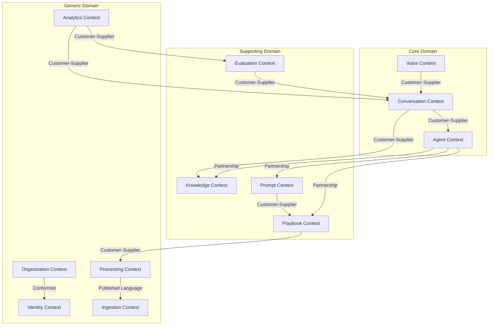

### Context Relationships

| Upstream | Downstream | Relationship | Integration |
|----------|-----------|-------------|-------------|
| Identity | Organization | Conformist | Shared DB |
| Ingestion | Processing | Published Language | Events |
| Processing | Playbook | Customer-Supplier | Events |
| Playbook | Prompt | Customer-Supplier | Events |
| Agent | Conversation | Customer-Supplier | Domain Service |
| Knowledge | Conversation | Customer-Supplier | Query Interface |
| Conversation | Evaluation | Customer-Supplier | Events |
| Conversation, Evaluation | Analytics | Customer-Supplier | Read Models |

---

## Bounded Context Details

---

### 1. Identity Context

**Responsibility**: Authentication, authorization, user management.

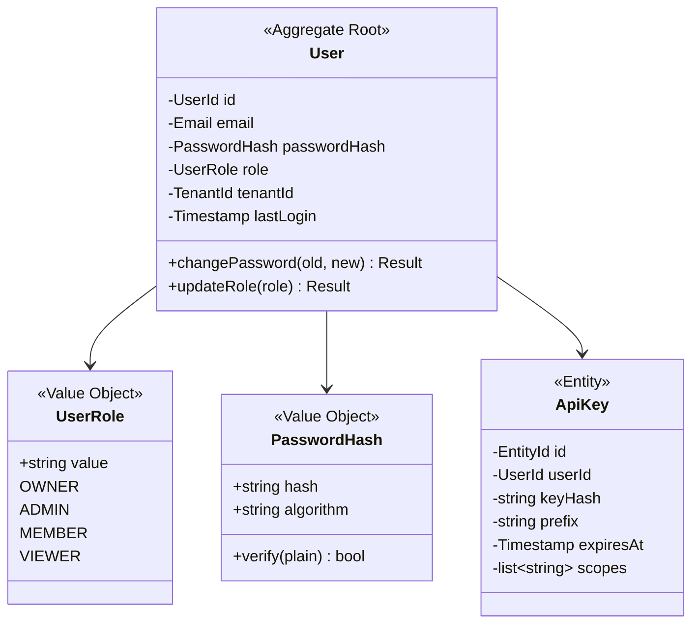

| Element | Type | Notes |
|---------|------|-------|
| `User` | Aggregate Root | Only root persisted via `UserRepository` |
| `ApiKey` | Entity (child) | Owned by User aggregate |
| `Email`, `PasswordHash`, `UserRole` | Value Objects | Self-validating, immutable |
| `UserRepository` | Repository Interface | `get_by_id`, `get_by_email`, `save`, `delete` |
| `UserFactory` | Factory | Creates user with hashed password |
| `UserRegistered` | Domain Event | Published on registration |
| `UserRoleChanged` | Domain Event | Published on role change |
| `AuthenticationService` | Domain Service | Validates credentials, issues tokens |

---

### 2. Organization Context

**Responsibility**: Multi-tenancy, workspaces, billing, feature flags.

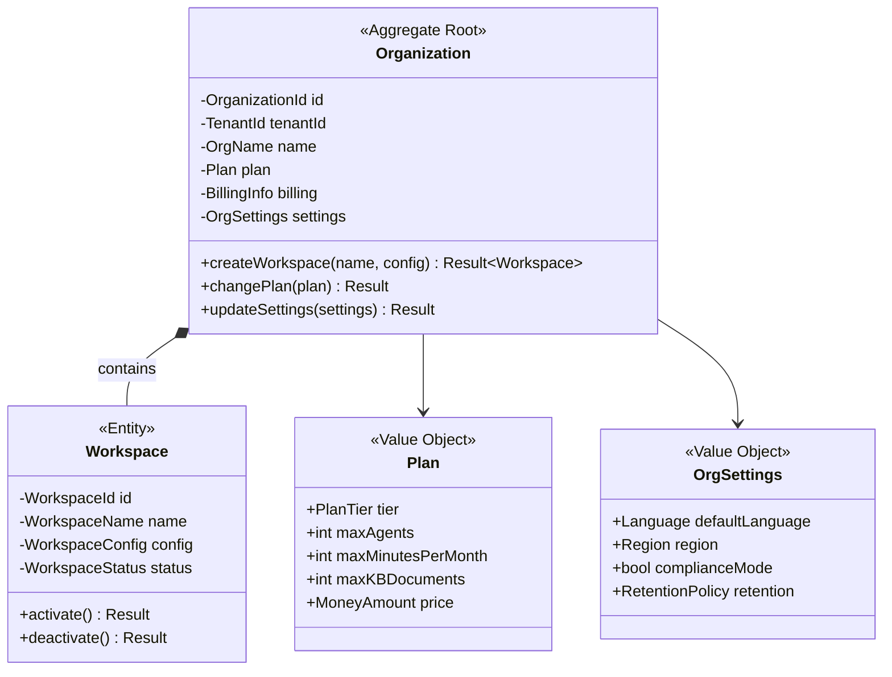

| Element | Type | Notes |
|---------|------|-------|
| `Organization` | Aggregate Root | Owns workspaces. Invariant: workspace count ≤ plan limit |
| `Workspace` | Entity (child) | Cannot exist without Organization |
| `Plan`, `OrgSettings` | Value Objects | Immutable config |
| `OrganizationRepository` | Repository Interface | |
| `OrganizationFactory` | Factory | Creates org with default workspace |
| `WorkspaceCreated`, `PlanChanged` | Domain Events | |

---

### 3. Agent Context

**Responsibility**: Agent lifecycle, configuration, deployment status.

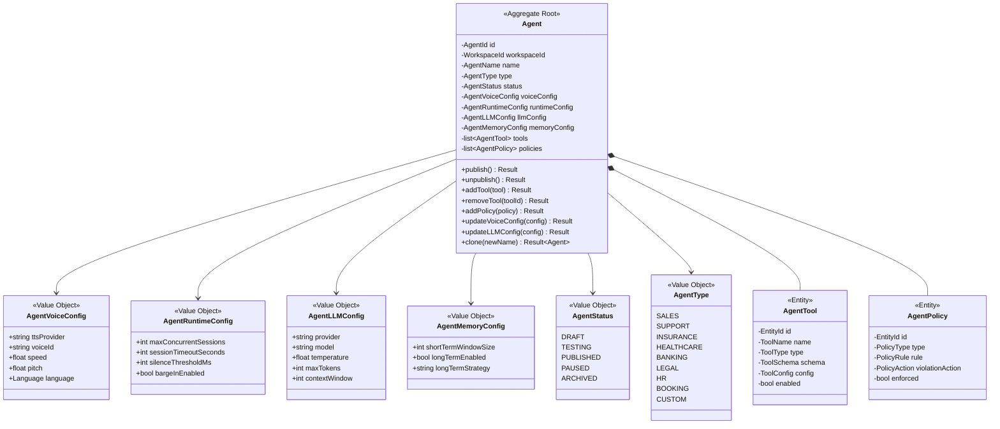

| Element | Type | Notes |
|---------|------|-------|
| `Agent` | Aggregate Root | Invariant: can only `publish()` if playbook + prompt exist |
| `AgentTool`, `AgentPolicy` | Entity (children) | Owned by Agent |
| `AgentVoiceConfig`, `AgentLLMConfig`, etc. | Value Objects | Replace JSON blobs |
| `AgentRepository` | Repository Interface | |
| `AgentFactory` | Factory | Creates agent with sensible defaults per type |
| `AgentPublished`, `AgentUnpublished`, `AgentCloned` | Domain Events | |

**Invariants**:
- Agent cannot be published without an active Playbook and Prompt.
- Agent tool count ≤ plan limit.
- Agent policies must contain at least one fallback policy.

---

### 4. Ingestion Context

**Responsibility**: Accept, validate, normalize, and store raw data.

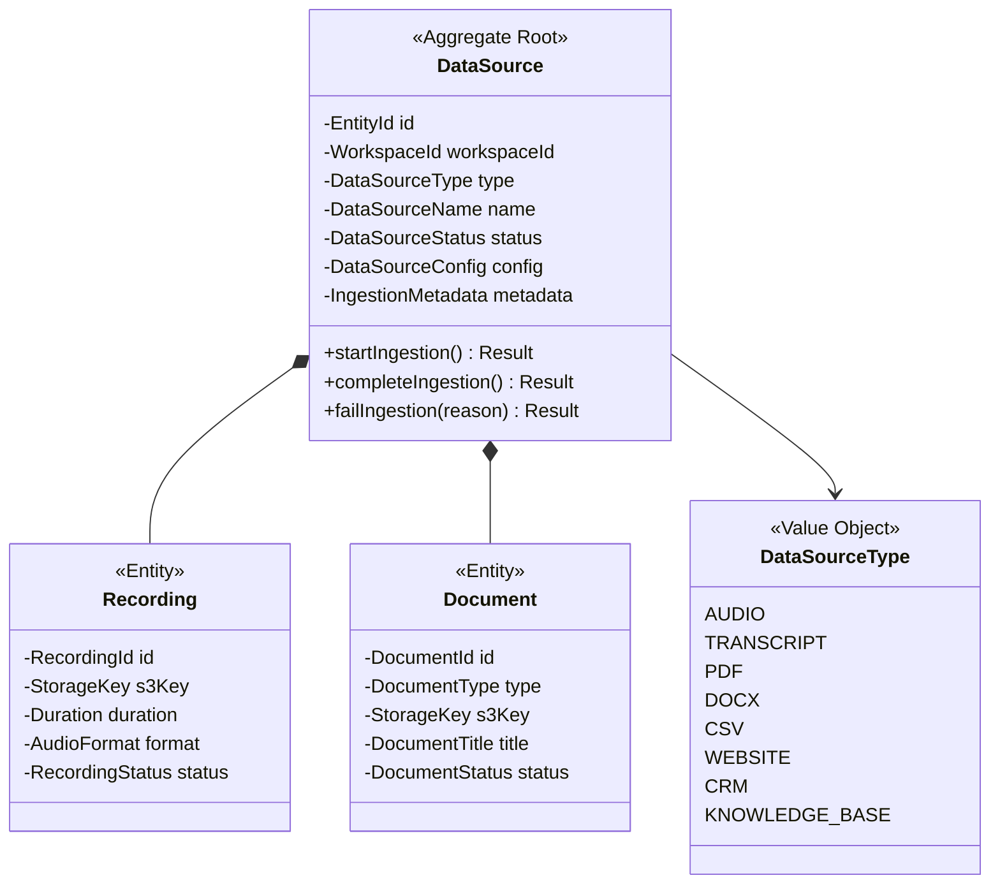

| Element | Type |
|---------|------|
| `DataSource` | Aggregate Root |
| `Recording`, `Document` | Entity (children) |
| `DataSourceRepository` | Repository Interface |
| `DataSourceFactory` | Factory |
| `RecordingUploaded`, `DocumentUploaded`, `IngestionCompleted`, `IngestionFailed` | Domain Events |

---

### 5. Processing Context

**Responsibility**: STT, diarization, sentiment, intent, topic segmentation.

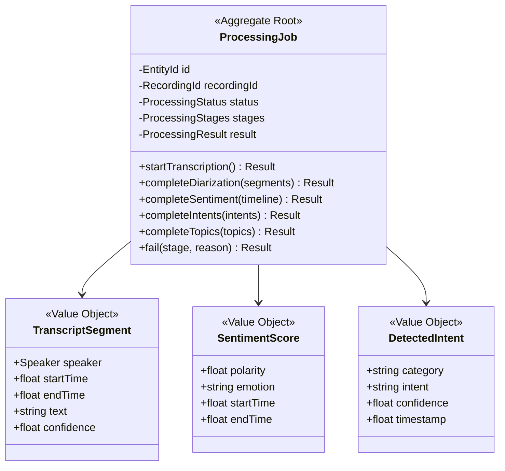

| Element | Type |
|---------|------|
| `ProcessingJob` | Aggregate Root |
| `TranscriptSegment`, `SentimentScore`, `DetectedIntent` | Value Objects |
| `ProcessingJobRepository` | Repository Interface |
| `ProcessingJobFactory` | Factory |
| `TranscriptGenerated`, `RecordingProcessed` | Domain Events |

---

### 6. Knowledge Context

**Responsibility**: RAG — indexing, chunking, embedding, retrieval, versioning.

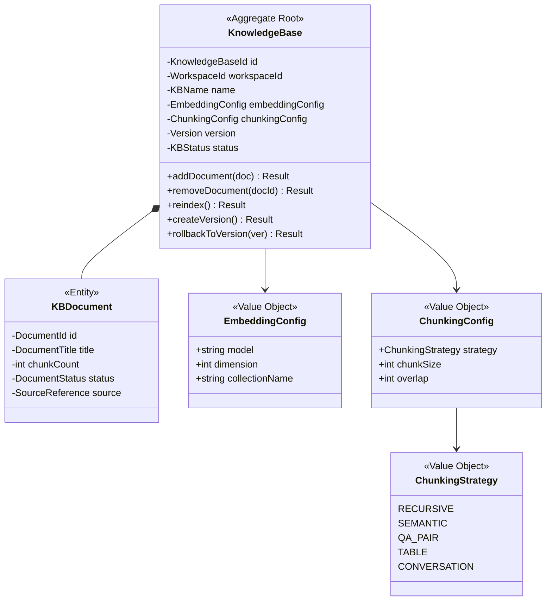

| Element | Type |
|---------|------|
| `KnowledgeBase` | Aggregate Root |
| `KBDocument` | Entity (child) |
| `KnowledgeBaseRepository` | Repository Interface |
| `KnowledgeBaseFactory` | Factory |
| `ChunkingStrategyResolver` | Strategy (selects chunker by doc type) |
| `RetrievalService` | Domain Service (hybrid search orchestration) |
| `KnowledgeIndexed`, `KnowledgeUpdated`, `KnowledgeVersionCreated` | Domain Events |

---

### 7. Playbook Context

**Responsibility**: Generate and version structured behavioral playbooks.

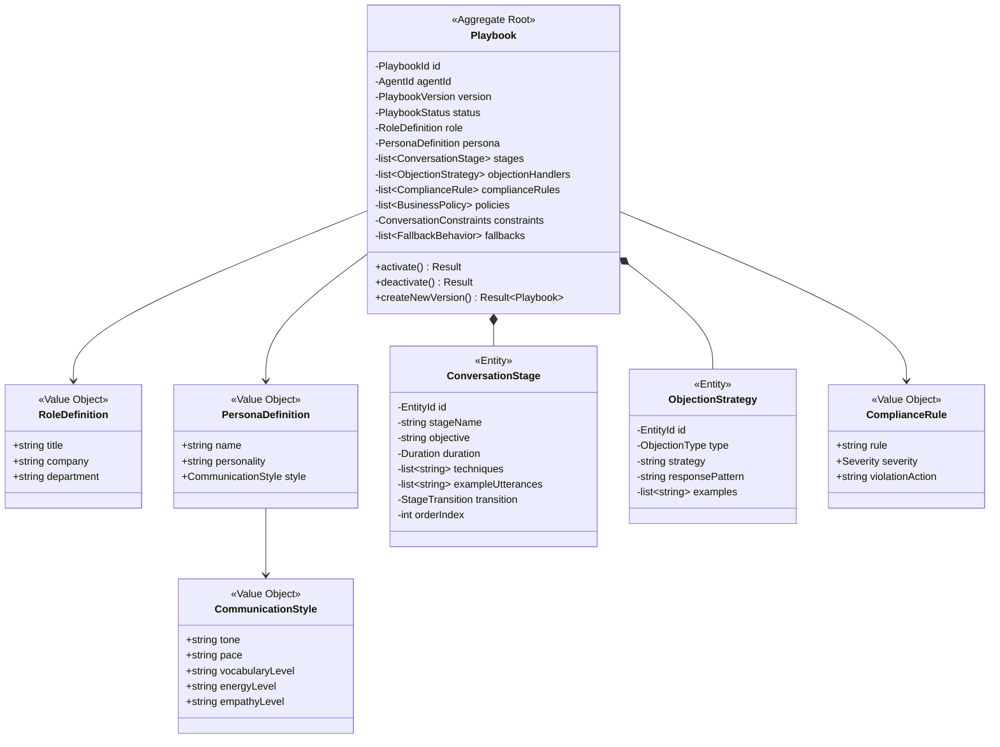

| Element | Type |
|---------|------|
| `Playbook` | Aggregate Root |
| `ConversationStage`, `ObjectionStrategy` | Entity (children) |
| `RoleDefinition`, `PersonaDefinition`, `ComplianceRule` | Value Objects |
| `PlaybookRepository` | Repository Interface |
| `PlaybookFactory`, `PlaybookBuilder` | Factory + Builder |
| `PlaybookMiningService` | Domain Service (LLM-powered extraction) |
| `PlaybookGenerated`, `PlaybookActivated` | Domain Events |

---

### 8. Prompt Context

**Responsibility**: Compile playbook into production system prompts.

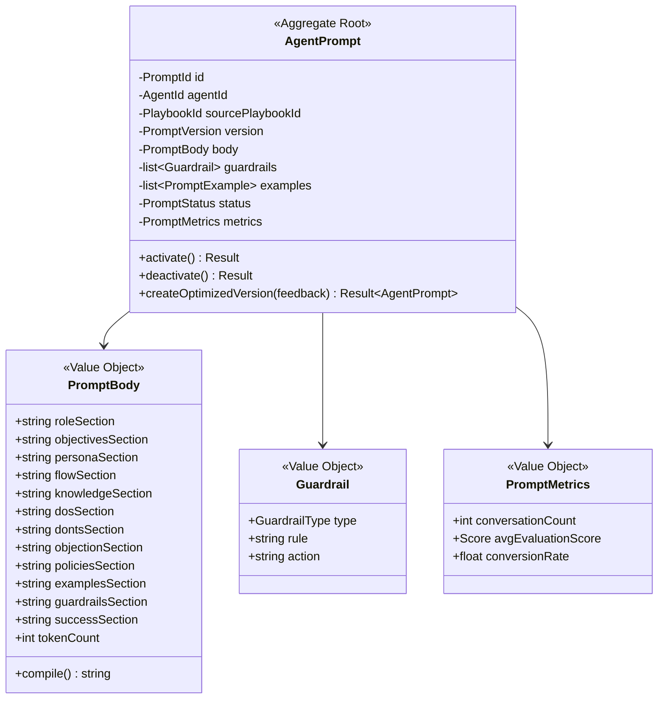

| Element | Type |
|---------|------|
| `AgentPrompt` | Aggregate Root |
| `PromptBody`, `Guardrail`, `PromptMetrics` | Value Objects |
| `AgentPromptRepository` | Repository Interface |
| `PromptCompiler` | Domain Service (playbook → prompt sections) |
| `PromptOptimizer` | Domain Service (evaluation → improvements) |
| `PromptFactory`, `PromptBuilder` | Factory + Builder |
| `PromptGenerated`, `PromptOptimized`, `PromptActivated` | Domain Events |

---

### 9. Conversation Context

**Responsibility**: Conversation lifecycle, turns, memory, real-time state.

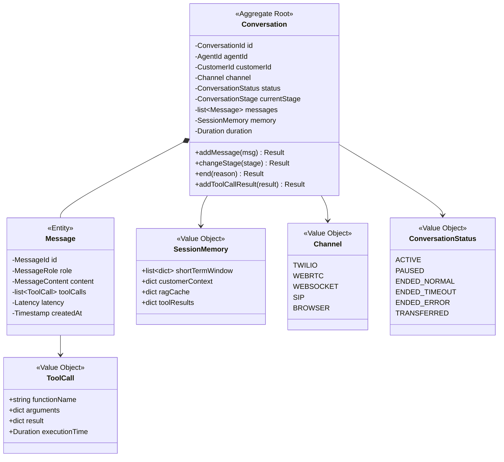

| Element | Type |
|---------|------|
| `Conversation` | Aggregate Root |
| `Message` | Entity (child) |
| `ToolCall`, `SessionMemory`, `Channel` | Value Objects |
| `ConversationRepository` | Repository Interface |
| `ConversationFactory` | Factory |
| `TurnProcessingService` | Domain Service (context + RAG + LLM) |
| `ConversationStarted`, `ConversationEnded`, `ToolExecuted` | Domain Events |

---

### 10. Voice Context

**Responsibility**: Real-time audio streaming, session management, media routing.

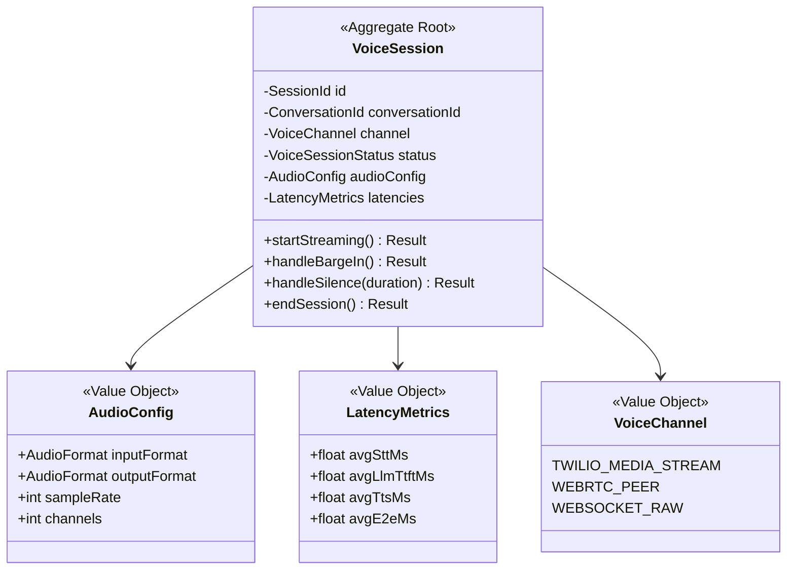

---

### 11. Evaluation Context

**Responsibility**: Score conversations, compliance, coaching feedback.

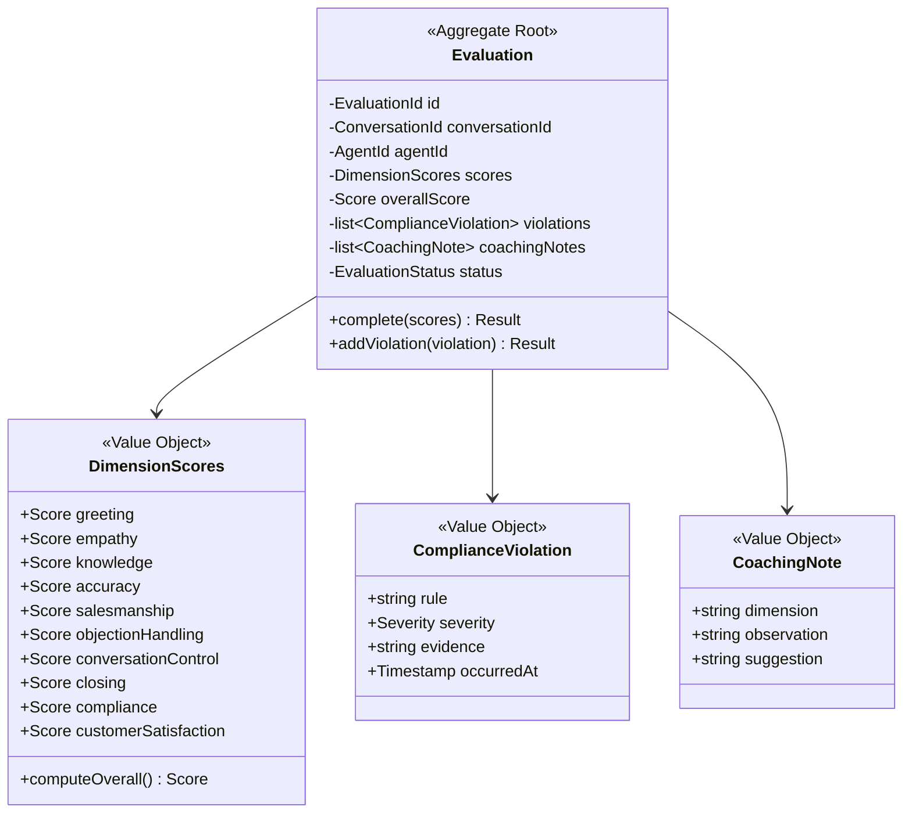

---

### 12. Analytics Context

**Responsibility**: Read models, dashboards, reports. CQRS query side.

This context is **read-only** — it consumes events from Conversation, Evaluation, and Agent contexts to build denormalized read models / materialized views.

| Read Model | Source Events | Purpose |
|------------|--------------|---------|
| `AgentPerformanceView` | `EvaluationCompleted`, `ConversationEnded` | Agent KPI dashboard |
| `SentimentTimelineView` | `RecordingProcessed` | Sentiment trends |
| `ConversationSummaryView` | `ConversationEnded` | Call summaries |
| `ComplianceReportView` | `EvaluationCompleted` | Compliance dashboard |
| `LeadScoreView` | `ConversationEnded` | Lead scoring |

---

## Domain Events — Full Registry

| Event | Publisher Context | Subscriber Context(s) | Payload |
|-------|------------------|----------------------|---------|
| `UserRegistered` | Identity | Organization | `userId, email` |
| `RecordingUploaded` | Ingestion | Processing | `recordingId, s3Key, workspaceId` |
| `DocumentUploaded` | Ingestion | Knowledge | `documentId, type, s3Key` |
| `IngestionCompleted` | Ingestion | — | `dataSourceId, stats` |
| `TranscriptGenerated` | Processing | Knowledge, Playbook | `recordingId, transcript` |
| `RecordingProcessed` | Processing | Playbook, Analytics | `recordingId, analysisId` |
| `PatternsExtracted` | Playbook | Prompt | `agentId, patternsSummary` |
| `PlaybookGenerated` | Playbook | Prompt, Agent | `playbookId, agentId, version` |
| `PlaybookActivated` | Playbook | Agent | `playbookId, agentId` |
| `PromptGenerated` | Prompt | Agent | `promptId, agentId, version` |
| `PromptOptimized` | Prompt | Agent | `promptId, newVersion` |
| `PromptActivated` | Prompt | Agent | `promptId, agentId` |
| `AgentPublished` | Agent | Voice, Analytics | `agentId, config` |
| `AgentUnpublished` | Agent | Voice | `agentId` |
| `KnowledgeIndexed` | Knowledge | Agent | `kbId, documentCount` |
| `KnowledgeUpdated` | Knowledge | Agent | `kbId, version` |
| `ConversationStarted` | Conversation | Analytics | `conversationId, agentId` |
| `ConversationEnded` | Conversation | Evaluation, Analytics | `conversationId, messages, duration` |
| `ToolExecuted` | Conversation | Analytics | `conversationId, toolName, result` |
| `EvaluationCompleted` | Evaluation | Analytics, Prompt | `evaluationId, scores` |
| `CustomerCreated` | Conversation | Analytics | `customerId, orgId` |

### Event Infrastructure Contract

```python
@dataclass(frozen=True)
class RecordingUploaded(DomainEvent):
    recording_id: str = ""
    workspace_id: str = ""
    s3_key: str = ""
    format: str = ""
    duration_seconds: float = 0.0

    # Infrastructure config (not domain)
    class Meta:
        exchange = "ingestion"
        routing_key = "recording.uploaded"
        retry_policy = RetryPolicy(max_retries=3, backoff="exponential")
        dead_letter_queue = "dlq.ingestion"
```

---

## Aggregate Invariant Summary

| Aggregate | Key Invariants |
|-----------|---------------|
| **Organization** | Workspace count ≤ plan.maxWorkspaces |
| **Agent** | Cannot publish without active Playbook + Prompt; Tools ≤ plan limit |
| **Playbook** | Must have ≥ 1 ConversationStage; Must have ≥ 1 FallbackBehavior |
| **AgentPrompt** | Token count ≤ LLM context window; Must pass safety scan |
| **KnowledgeBase** | Document count ≤ plan limit; Embedding dim = configured dim |
| **Conversation** | Cannot add messages after ENDED; Turn alternation enforced |
| **Evaluation** | All 10 dimension scores must be present; Overall = weighted avg |
| **VoiceSession** | Cannot barge-in during SILENCE state |
