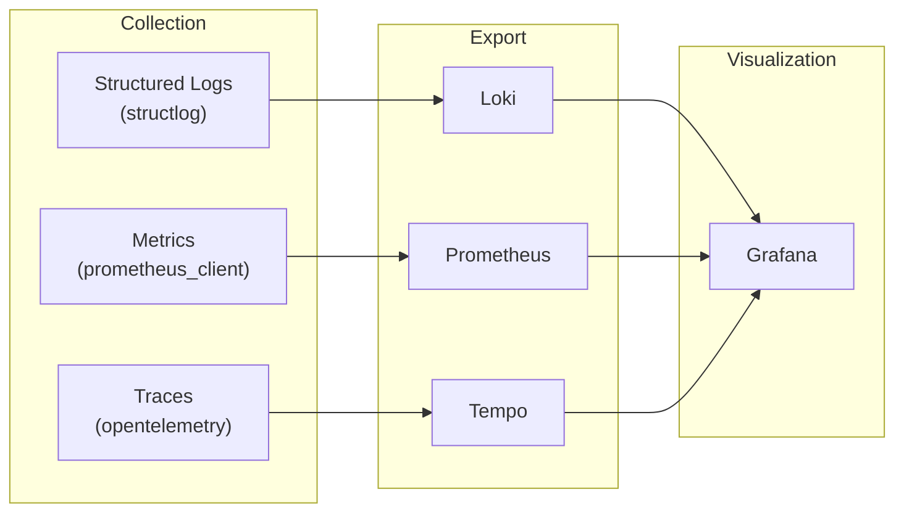
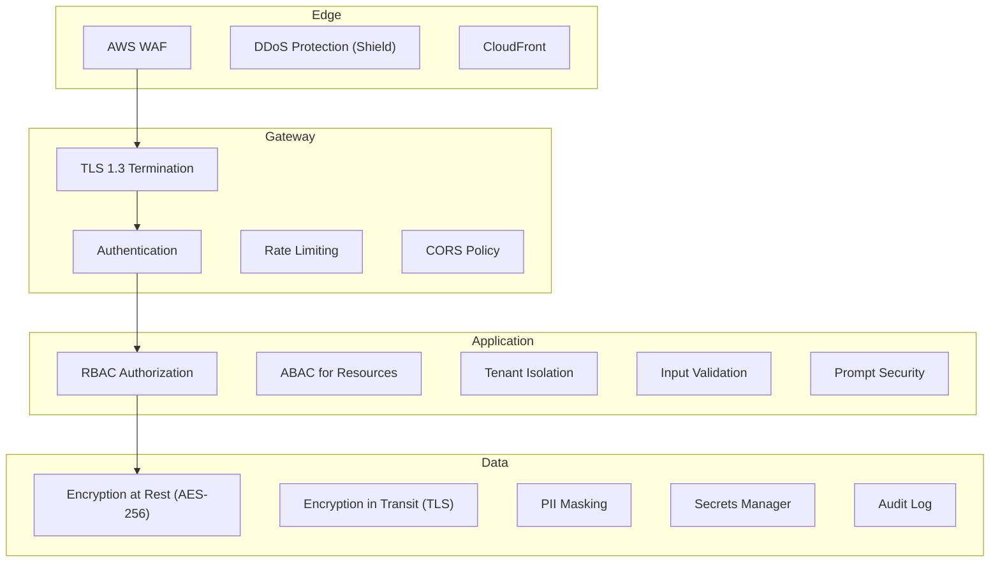
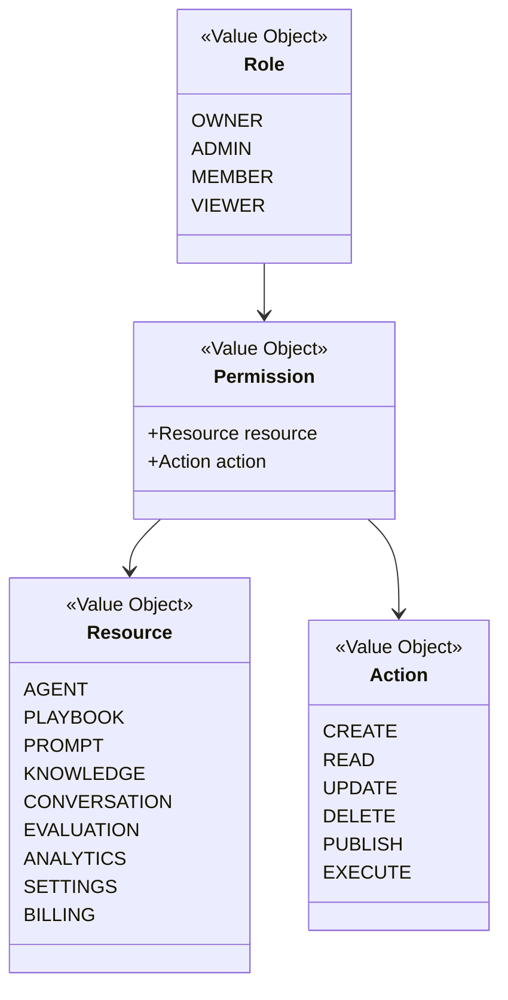

# 00c. Cross-Cutting Concerns & Security Architecture

> **Enterprise Architecture Review — New Foundation Document**
>
> Defines infrastructure for logging, caching, observability, security, and other
> cross-cutting concerns that span all bounded contexts without polluting domain logic.

---

## Architectural Principle

Cross-cutting concerns are **NOT** mixed into domain code. They are implemented via:

1. **Middleware** (Presentation layer)
2. **Decorators** (Application layer — wrapping use-case handlers)
3. **Infrastructure services** (injected via ports)
4. **Aspect-oriented composition** at the DI container level

```mermaid
graph TB
    subgraph "Request Pipeline"
        REQ["Incoming Request"]
        MW1["Auth Middleware"]
        MW2["Rate Limit Middleware"]
        MW3["Correlation ID Middleware"]
        MW4["Logging Middleware"]
        HANDLER["Use Case Handler"]
        DEC1["Logging Decorator"]
        DEC2["Caching Decorator"]
        DEC3["Validation Decorator"]
        DEC4["Transaction Decorator"]
        DEC5["Metrics Decorator"]
    end

    REQ --> MW1 --> MW2 --> MW3 --> MW4
    MW4 --> DEC1 --> DEC2 --> DEC3 --> DEC4 --> DEC5 --> HANDLER
```



---

## 1. Logging Architecture

### Policy

| Rule | Detail |
|------|--------|
| Library | `structlog` (structured JSON in prod, pretty in dev) |
| Domain layer | **NEVER** imports a logger directly |
| Application layer | Logs via decorator, not inline |
| Sensitive data | PII is masked before logging |
| Correlation | Every log carries `correlation_id`, `tenant_id`, `user_id` |

### Decorator

```python
# shared/infrastructure/decorators/logging_decorator.py
class LoggingDecorator(CommandHandler[TCommand, TResult]):
    """Wraps a command handler with structured logging."""

    def __init__(self, inner: CommandHandler, logger: Logger):
        self._inner = inner
        self._logger = logger

    async def handle(self, command: TCommand) -> Result[TResult]:
        self._logger.info("command.started",
                          command_type=type(command).__name__,
                          tenant_id=command.tenant_id)
        try:
            result = await self._inner.handle(command)
            if result.is_success:
                self._logger.info("command.succeeded",
                                  command_type=type(command).__name__)
            else:
                self._logger.warning("command.failed",
                                     error=result.error.code)
            return result
        except Exception as e:
            self._logger.error("command.exception",
                               command_type=type(command).__name__,
                               error=str(e))
            raise
```

---

## 2. Caching Architecture

### Cache Strategy

| Pattern | Use Case | TTL |
|---------|----------|-----|
| **Cache-Aside** | Agent config, playbook, prompt | 5 min |
| **Write-Through** | Session memory | Real-time |
| **Read-Through** | Knowledge search results | 2 min |
| **Invalidation** | On domain events (e.g., `AgentPublished`) | — |

### Decorator

```python
# shared/infrastructure/decorators/caching_decorator.py
class CachingDecorator(QueryHandler[TQuery, TResult]):
    """Wraps a query handler with cache-aside pattern."""

    def __init__(self, inner: QueryHandler, cache: CachePort, ttl: int):
        self._inner = inner
        self._cache = cache
        self._ttl = ttl

    async def handle(self, query: TQuery) -> Result[TResult]:
        cache_key = self._build_key(query)
        cached = await self._cache.get(cache_key)
        if cached:
            return Result.ok(deserialize(cached))
        result = await self._inner.handle(query)
        if result.is_success:
            await self._cache.set(cache_key, serialize(result.value), self._ttl)
        return result
```

---

## 3. Observability

### Three Pillars



### Metrics Decorator

```python
class MetricsDecorator(CommandHandler[TCommand, TResult]):
    def __init__(self, inner: CommandHandler, metrics: MetricsPort):
        self._inner = inner
        self._metrics = metrics

    async def handle(self, command: TCommand) -> Result[TResult]:
        name = type(command).__name__
        self._metrics.increment(f"command.{name}.started")
        start = time.monotonic()
        result = await self._inner.handle(command)
        duration = time.monotonic() - start
        self._metrics.histogram(f"command.{name}.duration", duration)
        if result.is_failure:
            self._metrics.increment(f"command.{name}.failed")
        return result
```

### Key Metrics

| Metric | Type | Labels |
|--------|------|--------|
| `http_requests_total` | Counter | `method, path, status` |
| `http_request_duration_seconds` | Histogram | `method, path` |
| `voice_session_active` | Gauge | `agent_id, channel` |
| `voice_latency_e2e_ms` | Histogram | `agent_id, stage` |
| `command_duration_seconds` | Histogram | `command_type` |
| `domain_events_published_total` | Counter | `event_type, context` |
| `celery_tasks_active` | Gauge | `task_name` |
| `qdrant_search_duration_ms` | Histogram | `collection` |
| `llm_tokens_total` | Counter | `provider, model, direction` |

---

## 4. Security Architecture

### Defense in Depth



### RBAC Model



### Permission Matrix

| Role | Agent | Playbook | Knowledge | Conversations | Evaluation | Settings | Billing |
|------|-------|----------|-----------|--------------|------------|----------|---------|
| **Owner** | CRUD+Publish | CRUD | CRUD | Read+Replay | Read | CRUD | CRUD |
| **Admin** | CRUD+Publish | CRUD | CRUD | Read+Replay | Read | Read+Update | Read |
| **Member** | Read+Update | Read | CRUD | Read | Read | Read | — |
| **Viewer** | Read | Read | Read | Read | Read | — | — |

### Tenant Isolation

| Layer | Mechanism |
|-------|-----------|
| **Database** | Row-Level Security (RLS) via `tenant_id` on every table |
| **Qdrant** | Namespace isolation: `kb_{workspace_id}` collection per tenant |
| **S3** | Prefix isolation: `s3://bucket/{org_id}/...` |
| **Redis** | Key prefix: `{tenant_id}:...` |
| **API** | Middleware extracts `tenant_id` from JWT, injects into all queries |

### Prompt Security (Injection Prevention)

| Threat | Mitigation |
|--------|-----------|
| Prompt injection | Input sanitization + guardrail LLM pre-check |
| Jailbreak attempts | System prompt hardened with role boundaries |
| Data exfiltration via prompt | Output scanning for PII/secrets |
| Knowledge poisoning | Document content scanning on upload |

### Authorization Decorator

```python
class AuthorizationDecorator(CommandHandler[TCommand, TResult]):
    def __init__(
        self, inner: CommandHandler,
        authorizer: AuthorizationPort,
        resource: Resource,
        action: Action
    ):
        self._inner = inner
        self._authorizer = authorizer
        self._resource = resource
        self._action = action

    async def handle(self, command: TCommand) -> Result[TResult]:
        allowed = await self._authorizer.check(
            user_id=command.user_id,
            tenant_id=command.tenant_id,
            resource=self._resource,
            action=self._action,
        )
        if not allowed:
            return Result.fail(Error("FORBIDDEN", "Insufficient permissions"))
        return await self._inner.handle(command)
```

---

## 5. Retry & Resilience

### Retry Policies

| Component | Strategy | Max Retries | Backoff |
|-----------|----------|-------------|---------|
| STT API | Exponential | 3 | 1s, 2s, 4s |
| TTS API | Exponential | 3 | 1s, 2s, 4s |
| LLM API | Exponential + Jitter | 3 | 1s, 2s, 4s |
| Qdrant | Exponential | 3 | 500ms, 1s, 2s |
| Database | Fixed delay | 2 | 500ms |
| Event publishing | Exponential | 5 | 1s → 16s |

### Circuit Breaker

```python
# shared/infrastructure/resilience/circuit_breaker.py
class CircuitBreaker:
    """
    States: CLOSED (normal) → OPEN (failing) → HALF_OPEN (testing)
    Wraps external adapter calls.
    """
    FAILURE_THRESHOLD = 5
    RECOVERY_TIMEOUT = 30  # seconds
    HALF_OPEN_MAX_CALLS = 3
```

### Dead Letter Queue

Failed events after max retries → DLQ for manual inspection.

```
exchange: dlq.{context}
routing_key: dlq.{event_type}
```

---

## 6. Configuration Management

```python
# shared/infrastructure/config.py
class AppSettings(BaseSettings):
    """
    Single source of truth for all configuration.
    Loaded from environment variables (12-factor app).
    Never imported in Domain layer.
    """
    model_config = SettingsConfigDict(env_prefix="VF_")

    # Database
    database_url: str
    database_pool_size: int = 20

    # Redis
    redis_url: str

    # S3
    s3_bucket: str
    s3_region: str = "us-east-1"

    # Providers (Strategy selection)
    stt_provider: str = "deepgram"       # deepgram | whisper | assemblyai
    tts_provider: str = "elevenlabs"     # elevenlabs | cartesia | google
    llm_provider: str = "gemini"         # gemini | openai | claude
    embedding_provider: str = "openai"

    # Feature Flags
    feature_ab_testing: bool = False
    feature_auto_optimization: bool = False
    feature_compliance_mode: bool = False
```

---

## 7. Feature Flags

```python
# shared/contracts/feature_flags.py
class FeatureFlagPort(ABC):
    @abstractmethod
    async def is_enabled(
        self, flag: str, tenant_id: str, default: bool = False
    ) -> bool: ...

# Usage in application layer (never domain):
class GeneratePlaybookHandler(CommandHandler):
    def __init__(self, flags: FeatureFlagPort, ...):
        self._flags = flags

    async def handle(self, cmd):
        if await self._flags.is_enabled("auto_optimization", cmd.tenant_id):
            # include optimization step
            ...
```

---

## 8. Audit Trail

| Field | Type | Description |
|-------|------|-------------|
| `event_id` | UUID | Unique audit event ID |
| `timestamp` | DateTime | When it occurred |
| `tenant_id` | UUID | Which organization |
| `user_id` | UUID | Who performed the action |
| `resource_type` | String | agent, playbook, prompt, etc. |
| `resource_id` | UUID | Which resource |
| `action` | String | created, updated, deleted, published |
| `changes` | JSON | Before/after diff |
| `ip_address` | String | Client IP |
| `user_agent` | String | Client identifier |

Stored in a separate `audit_log` table. Append-only. Never modified or deleted.

---

## Decorator Composition (DI Container)

The DI container composes decorators around handlers in a specific order:

```python
# Outermost → Innermost
handler = CreateAgentHandler(repo, factory)                # Business logic
handler = ValidationDecorator(handler, validator)          # Input validation
handler = AuthorizationDecorator(handler, auth, AGENT, CREATE)  # Authz
handler = TransactionDecorator(handler, uow)               # DB transaction
handler = LoggingDecorator(handler, logger)                 # Structured logging
handler = MetricsDecorator(handler, metrics)                # Prometheus metrics
handler = RetryDecorator(handler, retry_policy)             # Resilience
```

This keeps every handler a single-responsibility class while composing complex behavior at the infrastructure boundary.
