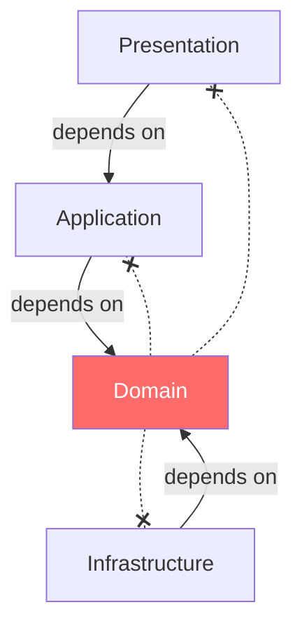
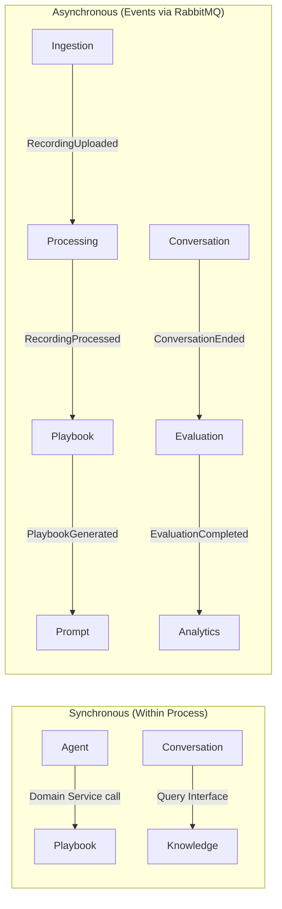

# 1. System Architecture — v2

> **Enterprise Architecture Review**
>
> **v1 Weaknesses**: Service-centric rather than domain-centric. No layer definitions.
> No dependency rules. No bounded context boundaries. Modules treated as services—encourages
> God services. Missing hexagonal ports/adapters distinction.
>
> **v2 Improvements**: Hexagonal Architecture with Clean Architecture layers.
> Domain at the center. Explicit bounded contexts. Dependency rules. No framework
> in domain. Decorator-based cross-cutting.

---

## Architectural Style: Hexagonal + Clean + DDD

```mermaid
graph TB
    subgraph "Presentation Layer (Driving Side)"
        REST["REST API<br/>(FastAPI Controllers)"]
        WS["WebSocket Server"]
        WEBHOOKS["Webhook Handlers"]
        CLI["CLI Tools"]
    end

    subgraph "Application Layer"
        CMD_BUS["Command Bus"]
        QUERY_BUS["Query Bus"]
        HANDLERS["Use Case Handlers"]
        APP_SVC["Application Services"]
    end

    subgraph "Domain Layer (CENTER)"
        ENTITIES["Entities & Aggregates"]
        VOS["Value Objects"]
        DOMAIN_SVC["Domain Services"]
        DOMAIN_EVENTS["Domain Events"]
        REPO_IF["Repository Interfaces"]
        PORT_IF["Port Interfaces"]
        SPECS["Specifications"]
        POLICIES["Domain Policies"]
    end

    subgraph "Infrastructure Layer (Driven Side)"
        DB_IMPL["PostgreSQL Repositories"]
        REDIS_IMPL["Redis Cache Adapter"]
        S3_IMPL["S3 Storage Adapter"]
        MQ_IMPL["RabbitMQ Event Bus Adapter"]
        QDRANT_IMPL["Qdrant Vector Adapter"]
    end

    subgraph "External Adapters (Driven Side)"
        STT_ADAPT["STT Adapters<br/>(Deepgram, Whisper, AssemblyAI)"]
        TTS_ADAPT["TTS Adapters<br/>(ElevenLabs, Cartesia, Google)"]
        LLM_ADAPT["LLM Adapters<br/>(Gemini, OpenAI, Claude)"]
        TEL_ADAPT["Telephony Adapter<br/>(Twilio, SIP)"]
    end

    REST --> CMD_BUS
    REST --> QUERY_BUS
    WS --> HANDLERS

    CMD_BUS --> HANDLERS
    QUERY_BUS --> HANDLERS
    HANDLERS --> DOMAIN_SVC
    HANDLERS --> ENTITIES
    HANDLERS --> REPO_IF
    HANDLERS --> PORT_IF

    DB_IMPL -.->|implements| REPO_IF
    REDIS_IMPL -.->|implements| PORT_IF
    S3_IMPL -.->|implements| PORT_IF
    MQ_IMPL -.->|implements| PORT_IF
    QDRANT_IMPL -.->|implements| PORT_IF
    STT_ADAPT -.->|implements| PORT_IF
    TTS_ADAPT -.->|implements| PORT_IF
    LLM_ADAPT -.->|implements| PORT_IF
    TEL_ADAPT -.->|implements| PORT_IF

    style ENTITIES fill:#ff6b6b,color:#fff
    style VOS fill:#ff6b6b,color:#fff
    style DOMAIN_SVC fill:#ff6b6b,color:#fff
    style DOMAIN_EVENTS fill:#ff6b6b,color:#fff
    style REPO_IF fill:#ff6b6b,color:#fff
    style PORT_IF fill:#ff6b6b,color:#fff
```



**Red = Domain Layer — zero framework dependencies, zero imports from other layers.**

---

## Dependency Rules (Inviolable)



### Allowed Dependencies

| Layer | May Import From |
|-------|----------------|
| **Shared Kernel** | Python stdlib only |
| **Domain** | Shared Kernel |
| **Application** | Domain, Shared Kernel |
| **Infrastructure** | Domain, Shared Kernel, frameworks, external libs |
| **Presentation** | Application, Shared Kernel, frameworks |

### Forbidden Dependencies

| Forbidden | Reason |
|-----------|--------|
| Domain → FastAPI | Framework in domain violates Hexagonal |
| Domain → SQLAlchemy | ORM in domain violates Clean Architecture |
| Domain → Redis/Qdrant | Infrastructure leak |
| Application → Infrastructure | Must go through abstractions (ports) |
| Any → Concrete external class | Always inject via interface |

---

## Layer Responsibilities

### Domain Layer

| Component | Responsibility | Example |
|-----------|---------------|---------|
| **Entity** | Identity + behavior + invariants | `Agent`, `Conversation` |
| **Aggregate Root** | Transaction boundary, owns events | `Agent`, `KnowledgeBase` |
| **Value Object** | Immutable, self-validating data | `AgentId`, `Email`, `Score` |
| **Domain Service** | Cross-aggregate logic | `TurnProcessingService` |
| **Domain Event** | Record of something that happened | `AgentPublished` |
| **Repository Interface** | Data access contract | `AgentRepository` |
| **Port Interface** | External capability contract | `STTPort`, `LLMPort` |
| **Specification** | Composable query predicate | `ActiveAgentSpec` |
| **Policy** | Business rule object | `CompliancePolicy` |

### Application Layer

| Component | Responsibility | Example |
|-----------|---------------|---------|
| **Command** | Intent to mutate state | `CreateAgentCommand` |
| **Query** | Intent to read state | `GetAgentQuery` |
| **Command Handler** | Orchestrate a write use case | `CreateAgentHandler` |
| **Query Handler** | Orchestrate a read use case | `GetAgentHandler` |
| **Application Service** | Complex multi-step orchestration | `AgentCloningOrchestrator` |
| **DTO** | Data transfer between layers | `AgentResponseDTO` |
| **Mapper** | Entity ↔ DTO conversion | `AgentMapper` |
| **Validator** | Input validation before domain | `CreateAgentValidator` |

### Infrastructure Layer

| Component | Responsibility | Example |
|-----------|---------------|---------|
| **Repository Impl** | Concrete data access | `PgAgentRepository` |
| **Adapter** | Concrete external integration | `DeepgramSTTAdapter` |
| **ORM Models** | Database table mapping | `AgentModel` (SQLAlchemy) |
| **Event Bus Impl** | Event publishing/subscription | `RabbitMQEventBus` |
| **Cache Impl** | Caching operations | `RedisCacheAdapter` |

### Presentation Layer

| Component | Responsibility | Example |
|-----------|---------------|---------|
| **Controller** | HTTP endpoint handler | `AgentController` |
| **Schema** | Request/response serialization | `CreateAgentRequest` |
| **Middleware** | Auth, rate limit, CORS | `AuthMiddleware` |
| **WebSocket Handler** | Real-time connections | `VoiceStreamHandler` |

---

## Bounded Context Integration



### Anti-Corruption Layer

When Context A consumes events from Context B, it uses an Anti-Corruption Layer (ACL) to translate B's domain language into A's:

```python
# processing/infrastructure/acl/ingestion_acl.py
class IngestionACL:
    """
    Translates Ingestion context events into Processing context commands.
    Prevents Ingestion's domain model from leaking into Processing.
    """

    def translate(self, event: RecordingUploaded) -> StartTranscriptionCommand:
        return StartTranscriptionCommand(
            recording_id=RecordingId(event.recording_id),
            storage_key=StorageKey(event.s3_key),
            audio_format=AudioFormat.from_string(event.format),
            tenant_id=TenantId(event.tenant_id),
        )
```

---

## Module Summary (Revised)

| # | Bounded Context | Aggregate Roots | Ports Required | Events Published |
|---|----------------|----------------|----------------|------------------|
| 1 | Identity | `User` | — | `UserRegistered` |
| 2 | Organization | `Organization` (+ `Workspace`) | — | `WorkspaceCreated`, `PlanChanged` |
| 3 | Agent | `Agent` | — | `AgentPublished`, `AgentCloned` |
| 4 | Ingestion | `DataSource` (+ `Recording`, `Document`) | `ObjectStoragePort` | `RecordingUploaded`, `DocumentUploaded` |
| 5 | Processing | `ProcessingJob` | `STTPort` | `TranscriptGenerated`, `RecordingProcessed` |
| 6 | Knowledge | `KnowledgeBase` (+ `KBDocument`) | `EmbeddingPort`, `VectorStorePort` | `KnowledgeIndexed`, `KnowledgeUpdated` |
| 7 | Playbook | `Playbook` | `LLMPort` | `PlaybookGenerated`, `PlaybookActivated` |
| 8 | Prompt | `AgentPrompt` | `LLMPort` | `PromptGenerated`, `PromptOptimized` |
| 9 | Conversation | `Conversation` (+ `Message`) | `LLMPort`, `CachePort` | `ConversationStarted`, `ConversationEnded` |
| 10 | Voice | `VoiceSession` | `STTPort`, `TTSPort`, `TelephonyPort` | — |
| 11 | Evaluation | `Evaluation` | `LLMPort` | `EvaluationCompleted` |
| 12 | Analytics | (Read Models only — CQRS query side) | `CachePort` | — |

---

## Design Principles — Applied

| Principle | How Applied |
|-----------|-------------|
| **SRP** | Every class has ONE reason to change. No God services. |
| **OCP** | New STT/TTS/LLM provider = new adapter class. Zero existing code changes. |
| **LSP** | All adapters are substitutable behind port interfaces. |
| **ISP** | `STTPort` and `TTSPort` are separate. No `VoiceProviderPort` fat interface. |
| **DIP** | Domain defines interfaces. Infrastructure implements them. |
| **Hexagonal** | Domain has zero framework deps. Ports = abstractions. Adapters = implementations. |
| **DDD** | Aggregates enforce invariants. Events capture state changes. Bounded contexts own their models. |
| **CQRS** | Commands mutate via aggregates. Queries read via denormalized views. |
| **Repository** | One repo per aggregate root. Interface in domain, impl in infrastructure. |
| **Factory** | Complex object creation encapsulated. `AgentFactory`, `PlaybookBuilder`. |
| **Strategy** | Runtime provider selection. Config → factory → concrete adapter. |
| **Adapter** | Every external dependency behind a port. Never imported directly. |
| **Builder** | Playbook and Prompt construction via multi-step builders. |
| **Event-Driven** | Bounded contexts communicate asynchronously via domain events. |
