# 2. Database Schema — v2

> **Enterprise Architecture Review**
>
> **v1 Weaknesses**: Massive JSON blobs (`voice_config`, `llm_config`, `metadata`, etc.)
> hiding relational structure. Violates normalization. Makes querying, indexing, and
> validation impossible at the DB level. No audit trail. No RLS policy definitions.
>
> **v2 Improvements**: Full 3NF normalization. JSON blobs exploded into proper relational
> tables. Audit log. RLS policies. Separate read models for CQRS query side.

---

## ER Diagram — Normalized

```mermaid
erDiagram
    ORGANIZATION ||--o{ WORKSPACE : has
    ORGANIZATION ||--o{ USER : has
    ORGANIZATION ||--|| PLAN : subscribes
    ORGANIZATION {
        uuid id PK
        uuid tenant_id UK
        varchar name
        uuid plan_id FK
        varchar default_language
        varchar region
        boolean compliance_mode
        int retention_days
        timestamp created_at
        timestamp updated_at
    }

    PLAN {
        uuid id PK
        varchar tier
        int max_agents
        int max_minutes_per_month
        int max_kb_documents
        int max_workspaces
        int price_cents
        varchar currency
    }

    USER {
        uuid id PK
        uuid org_id FK
        varchar email UK
        varchar password_hash
        varchar password_algorithm
        varchar role
        timestamp last_login
        timestamp created_at
    }

    API_KEY {
        uuid id PK
        uuid user_id FK
        varchar key_hash
        varchar prefix
        varchar scopes
        timestamp expires_at
        timestamp created_at
    }

    USER ||--o{ API_KEY : owns

    WORKSPACE {
        uuid id PK
        uuid org_id FK
        varchar name
        varchar status
        timestamp created_at
    }

    WORKSPACE ||--o{ AGENT : contains
    WORKSPACE ||--o{ KNOWLEDGE_BASE : contains
    WORKSPACE ||--o{ DATA_SOURCE : contains

    AGENT {
        uuid id PK
        uuid workspace_id FK
        varchar name
        varchar type
        varchar status
        timestamp created_at
        timestamp updated_at
        int version
    }

    AGENT ||--|| AGENT_VOICE_CONFIG : has
    AGENT ||--|| AGENT_RUNTIME_CONFIG : has
    AGENT ||--|| AGENT_LLM_CONFIG : has
    AGENT ||--|| AGENT_MEMORY_CONFIG : has
    AGENT ||--o{ AGENT_TOOL : uses
    AGENT ||--o{ AGENT_POLICY : enforces
    AGENT ||--o{ PLAYBOOK : has
    AGENT ||--o{ AGENT_PROMPT : has

    AGENT_VOICE_CONFIG {
        uuid id PK
        uuid agent_id FK
        varchar tts_provider
        varchar voice_id
        decimal speed
        decimal pitch
        varchar language
    }

    AGENT_RUNTIME_CONFIG {
        uuid id PK
        uuid agent_id FK
        int max_concurrent_sessions
        int session_timeout_seconds
        int silence_threshold_ms
        boolean barge_in_enabled
    }

    AGENT_LLM_CONFIG {
        uuid id PK
        uuid agent_id FK
        varchar provider
        varchar model
        decimal temperature
        int max_tokens
        int context_window
    }

    AGENT_MEMORY_CONFIG {
        uuid id PK
        uuid agent_id FK
        int short_term_window_size
        boolean long_term_enabled
        varchar long_term_strategy
    }

    AGENT_TOOL {
        uuid id PK
        uuid agent_id FK
        varchar name
        varchar type
        text schema_json
        text config_json
        boolean enabled
    }

    AGENT_POLICY {
        uuid id PK
        uuid agent_id FK
        varchar type
        text rule
        varchar violation_action
        boolean enforced
        int priority
    }

    DATA_SOURCE ||--o{ RECORDING : produces
    DATA_SOURCE ||--o{ DOCUMENT : produces
    DATA_SOURCE {
        uuid id PK
        uuid workspace_id FK
        varchar type
        varchar name
        varchar status
        varchar source_url
        timestamp created_at
    }

    RECORDING {
        uuid id PK
        uuid data_source_id FK
        varchar s3_key
        int duration_seconds
        varchar format
        int sample_rate
        int channels
        varchar status
        timestamp created_at
    }

    RECORDING ||--o| TRANSCRIPT : has
    RECORDING ||--o| CALL_ANALYSIS : has

    TRANSCRIPT {
        uuid id PK
        uuid recording_id FK
        text full_text
        decimal confidence
        decimal duration_seconds
        int word_count
        timestamp created_at
    }

    TRANSCRIPT ||--o{ TRANSCRIPT_SEGMENT : contains
    TRANSCRIPT_SEGMENT {
        uuid id PK
        uuid transcript_id FK
        varchar speaker
        decimal start_time
        decimal end_time
        text content
        decimal confidence
        int order_index
    }

    CALL_ANALYSIS {
        uuid id PK
        uuid recording_id FK
        decimal agent_score
        varchar outcome
        timestamp created_at
    }

    CALL_ANALYSIS ||--o{ SENTIMENT_ENTRY : has
    CALL_ANALYSIS ||--o{ DETECTED_INTENT : has
    CALL_ANALYSIS ||--o{ TOPIC_SEGMENT : has
    CALL_ANALYSIS ||--o{ SPEAKER_STAT : has

    SENTIMENT_ENTRY {
        uuid id PK
        uuid analysis_id FK
        decimal polarity
        varchar emotion
        decimal start_time
        decimal end_time
    }

    DETECTED_INTENT {
        uuid id PK
        uuid analysis_id FK
        varchar category
        varchar intent
        decimal confidence
        decimal timestamp_sec
    }

    TOPIC_SEGMENT {
        uuid id PK
        uuid analysis_id FK
        varchar topic
        decimal start_time
        decimal end_time
        int order_index
    }

    SPEAKER_STAT {
        uuid id PK
        uuid analysis_id FK
        varchar speaker
        decimal talk_ratio
        int word_count
        decimal avg_sentiment
    }

    DOCUMENT {
        uuid id PK
        uuid data_source_id FK
        varchar type
        varchar s3_key
        varchar title
        varchar status
        int page_count
        timestamp created_at
    }

    PLAYBOOK {
        uuid id PK
        uuid agent_id FK
        int version
        varchar status
        boolean is_active
        timestamp created_at
    }

    PLAYBOOK ||--|| PLAYBOOK_ROLE : defines
    PLAYBOOK ||--|| PLAYBOOK_PERSONA : defines
    PLAYBOOK ||--o{ CONVERSATION_STAGE : contains
    PLAYBOOK ||--o{ OBJECTION_STRATEGY : contains
    PLAYBOOK ||--o{ COMPLIANCE_RULE : contains
    PLAYBOOK ||--o{ BUSINESS_POLICY : contains
    PLAYBOOK ||--o{ FALLBACK_BEHAVIOR : contains
    PLAYBOOK ||--|| CONVERSATION_CONSTRAINTS : defines

    PLAYBOOK_ROLE {
        uuid id PK
        uuid playbook_id FK
        varchar title
        varchar company
        varchar department
    }

    PLAYBOOK_PERSONA {
        uuid id PK
        uuid playbook_id FK
        varchar name
        varchar personality
        varchar tone
        varchar pace
        varchar vocabulary_level
        varchar energy_level
        varchar empathy_level
    }

    CONVERSATION_STAGE {
        uuid id PK
        uuid playbook_id FK
        varchar stage_name
        text objective
        int duration_seconds_min
        int duration_seconds_max
        int order_index
        varchar next_stage
        varchar transition_trigger
    }

    CONVERSATION_STAGE ||--o{ STAGE_TECHNIQUE : uses
    CONVERSATION_STAGE ||--o{ STAGE_EXAMPLE : demonstrates
    CONVERSATION_STAGE ||--o{ DISCOVERY_QUESTION : asks

    STAGE_TECHNIQUE {
        uuid id PK
        uuid stage_id FK
        text technique
        int order_index
    }

    STAGE_EXAMPLE {
        uuid id PK
        uuid stage_id FK
        text utterance
        int order_index
    }

    DISCOVERY_QUESTION {
        uuid id PK
        uuid stage_id FK
        varchar priority
        text question
        int order_index
    }

    OBJECTION_STRATEGY {
        uuid id PK
        uuid playbook_id FK
        varchar objection_type
        varchar strategy_name
        text response_pattern
    }

    OBJECTION_STRATEGY ||--o{ OBJECTION_EXAMPLE : demonstrates

    OBJECTION_EXAMPLE {
        uuid id PK
        uuid strategy_id FK
        text utterance
        int order_index
    }

    COMPLIANCE_RULE {
        uuid id PK
        uuid playbook_id FK
        text rule
        varchar severity
        varchar violation_action
    }

    BUSINESS_POLICY {
        uuid id PK
        uuid playbook_id FK
        text policy
        varchar category
    }

    FALLBACK_BEHAVIOR {
        uuid id PK
        uuid playbook_id FK
        varchar trigger
        text response
    }

    CONVERSATION_CONSTRAINTS {
        uuid id PK
        uuid playbook_id FK
        int max_duration_seconds
        int max_consecutive_questions
        int silence_threshold_seconds
        varchar profanity_response
        varchar off_topic_response
    }

    AGENT_PROMPT {
        uuid id PK
        uuid agent_id FK
        uuid playbook_id FK
        int version
        varchar status
        boolean is_active
        int token_count
        int conversation_count
        decimal avg_eval_score
        decimal conversion_rate
        timestamp created_at
    }

    AGENT_PROMPT ||--o{ PROMPT_SECTION : contains
    AGENT_PROMPT ||--o{ PROMPT_GUARDRAIL : enforces
    AGENT_PROMPT ||--o{ PROMPT_EXAMPLE : demonstrates

    PROMPT_SECTION {
        uuid id PK
        uuid prompt_id FK
        varchar section_type
        text content
        int order_index
        int token_count
    }

    PROMPT_GUARDRAIL {
        uuid id PK
        uuid prompt_id FK
        varchar type
        text rule
        varchar action
    }

    PROMPT_EXAMPLE {
        uuid id PK
        uuid prompt_id FK
        varchar category
        text user_input
        text agent_response
        int order_index
    }

    KNOWLEDGE_BASE {
        uuid id PK
        uuid workspace_id FK
        varchar name
        varchar embedding_model
        int embedding_dimension
        varchar qdrant_collection
        varchar chunking_strategy
        int chunk_size
        int chunk_overlap
        int version
        varchar status
        timestamp created_at
    }

    KNOWLEDGE_BASE ||--o{ KB_DOCUMENT : contains

    KB_DOCUMENT {
        uuid id PK
        uuid kb_id FK
        uuid source_document_id FK
        varchar title
        int chunk_count
        varchar status
        varchar category
        timestamp created_at
    }

    CONVERSATION ||--o{ MESSAGE : contains
    CONVERSATION ||--o| CONVERSATION_EVALUATION : evaluated_by

    CONVERSATION {
        uuid id PK
        uuid agent_id FK
        uuid customer_id FK
        varchar channel
        varchar status
        varchar current_stage
        int duration_seconds
        int turn_count
        timestamp started_at
        timestamp ended_at
    }

    MESSAGE {
        uuid id PK
        uuid conversation_id FK
        varchar role
        text content
        decimal latency_ms
        int order_index
        timestamp created_at
    }

    MESSAGE ||--o{ TOOL_CALL : invokes

    TOOL_CALL {
        uuid id PK
        uuid message_id FK
        varchar function_name
        text arguments_json
        text result_json
        int execution_ms
    }

    CONVERSATION_EVALUATION {
        uuid id PK
        uuid conversation_id FK
        uuid agent_id FK
        decimal greeting_score
        decimal empathy_score
        decimal knowledge_score
        decimal accuracy_score
        decimal salesmanship_score
        decimal objection_handling_score
        decimal conversation_control_score
        decimal closing_score
        decimal compliance_score
        decimal customer_satisfaction_score
        decimal overall_score
        varchar status
        timestamp created_at
    }

    CONVERSATION_EVALUATION ||--o{ EVAL_DETAIL : explains
    CONVERSATION_EVALUATION ||--o{ COMPLIANCE_VIOLATION : reports
    CONVERSATION_EVALUATION ||--o{ COACHING_NOTE : suggests

    EVAL_DETAIL {
        uuid id PK
        uuid evaluation_id FK
        varchar dimension
        decimal score
        text evidence
        text suggestion
    }

    COMPLIANCE_VIOLATION {
        uuid id PK
        uuid evaluation_id FK
        text rule
        varchar severity
        text evidence
        timestamp occurred_at
    }

    COACHING_NOTE {
        uuid id PK
        uuid evaluation_id FK
        varchar dimension
        text observation
        text suggestion
    }

    CUSTOMER {
        uuid id PK
        uuid org_id FK
        varchar external_id
        varchar name
        varchar phone
        varchar email
        timestamp created_at
    }

    CUSTOMER ||--o{ CUSTOMER_ATTRIBUTE : has

    CUSTOMER_ATTRIBUTE {
        uuid id PK
        uuid customer_id FK
        varchar attribute_key
        text attribute_value
        varchar source
        timestamp updated_at
    }

    AUDIT_LOG {
        uuid id PK
        uuid tenant_id
        uuid user_id
        varchar resource_type
        uuid resource_id
        varchar action
        text changes_json
        varchar ip_address
        varchar user_agent
        timestamp created_at
    }
```



---

## Row-Level Security (RLS)

```sql
-- Every table with tenant data gets RLS
ALTER TABLE agent ENABLE ROW LEVEL SECURITY;

CREATE POLICY tenant_isolation ON agent
    USING (workspace_id IN (
        SELECT id FROM workspace WHERE org_id = current_setting('app.tenant_id')::uuid
    ));

-- Set tenant context per request
SET LOCAL app.tenant_id = '{org_id}';
```

Applied to: `agent`, `playbook`, `agent_prompt`, `knowledge_base`, `conversation`, `data_source`, `recording`, `document`, `customer`, `conversation_evaluation`.

---

## Key Indexes

| Table | Index | Type | Purpose |
|-------|-------|------|---------|
| `agent` | `(workspace_id, status)` | B-tree | Agent listing |
| `agent` | `(workspace_id, type)` | B-tree | Agent type filter |
| `playbook` | `(agent_id, is_active)` | B-tree | Active playbook lookup |
| `agent_prompt` | `(agent_id, is_active)` | B-tree | Active prompt lookup |
| `conversation` | `(agent_id, started_at DESC)` | B-tree | Recent conversations |
| `conversation` | `(customer_id)` | B-tree | Customer history |
| `message` | `(conversation_id, order_index)` | B-tree | Message ordering |
| `transcript_segment` | `(transcript_id, order_index)` | B-tree | Segment ordering |
| `conversation_evaluation` | `(agent_id, overall_score)` | B-tree | Agent ranking |
| `audit_log` | `(tenant_id, created_at DESC)` | B-tree | Audit queries |
| `customer` | `(org_id, external_id)` | B-tree, Unique | CRM dedup |
| `customer` | `(org_id, phone)` | B-tree | Phone lookup |

---

## CQRS Read Models (Materialized Views)

```sql
-- Agent performance view (refreshed by EvaluationCompleted event handler)
CREATE MATERIALIZED VIEW agent_performance_view AS
SELECT
    a.id as agent_id,
    a.workspace_id,
    a.name as agent_name,
    COUNT(DISTINCT c.id) as total_conversations,
    AVG(ce.overall_score) as avg_score,
    AVG(ce.greeting_score) as avg_greeting,
    AVG(ce.empathy_score) as avg_empathy,
    AVG(ce.knowledge_score) as avg_knowledge,
    AVG(ce.compliance_score) as avg_compliance,
    COUNT(cv.id) as total_violations,
    AVG(c.duration_seconds) as avg_duration
FROM agent a
LEFT JOIN conversation c ON c.agent_id = a.id
LEFT JOIN conversation_evaluation ce ON ce.conversation_id = c.id
LEFT JOIN compliance_violation cv ON cv.evaluation_id = ce.id
GROUP BY a.id, a.workspace_id, a.name;

-- Sentiment timeline view
CREATE MATERIALIZED VIEW sentiment_timeline_view AS
SELECT
    ca.id as analysis_id,
    r.data_source_id,
    se.polarity,
    se.emotion,
    se.start_time,
    se.end_time
FROM sentiment_entry se
JOIN call_analysis ca ON se.analysis_id = ca.id
JOIN recording r ON ca.recording_id = r.id;
```

---

## Redis Data Model (Unchanged — Well-Designed)

| Key Pattern | Type | Purpose | TTL |
|-------------|------|---------|-----|
| `{tenant_id}:session:{conv_id}` | Hash | Active conversation state | 2h |
| `{tenant_id}:memory:{conv_id}` | List | Short-term conversation memory | 2h |
| `{tenant_id}:agent:config:{agent_id}` | Hash | Cached agent configuration | 5m |
| `{tenant_id}:rate:{endpoint}` | String | Rate limiting counter | 60s |
| `lock:{resource}` | String | Distributed lock | 30s |

---

## Qdrant Collections (Unchanged — Well-Designed)

| Collection | Vector Dim | Key Payload Fields |
|------------|-----------|-------------------|
| `kb_{workspace_id}` | 1536/768 | `doc_id, chunk_idx, source, category, org_id` |
| `conversations_{workspace_id}` | 1536/768 | `conv_id, role, agent_id, timestamp` |
| `playbook_examples_{agent_id}` | 1536/768 | `stage, category, quality_score` |

---

## Migration Strategy

All schema changes managed via **Alembic** with:
- One migration per bounded context change
- Forward-only migrations in production (no downgrades)
- Data migrations separated from schema migrations
