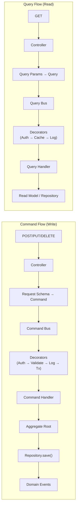

# 4. API Design — v2

> **Enterprise Architecture Review**
>
> **v1 Weaknesses**: No CQRS separation — all endpoints are flat CRUD. No command/query
> distinction. Schemas not linked to domain DTOs. No versioning strategy for breaking changes.
>
> **v2 Improvements**: Explicit CQRS — POST endpoints dispatch Commands, GET endpoints
> dispatch Queries. Controllers are thin (dispatch only). Schemas map to application DTOs.
> Error codes mapped to domain Result failures.

---

## CQRS: Commands vs Queries

**Principle**: Every API endpoint dispatches either a Command (mutates state) or a Query (reads state). Controllers contain zero business logic.



---

## Controller Pattern

```python
# presentation/api/v1/agents_controller.py
class AgentsController:
    """
    Thin controller. No business logic.
    Translates HTTP → Command/Query, dispatches, translates Result → Response.
    """

    def __init__(self, command_bus: CommandBus, query_bus: QueryBus):
        self._command_bus = command_bus
        self._query_bus = query_bus

    # COMMAND endpoint
    async def create_agent(self, request: CreateAgentRequest) -> CreateAgentResponse:
        command = CreateAgentCommand(
            tenant_id=request.tenant_id,
            workspace_id=request.workspace_id,
            name=request.name,
            type=request.type,
        )
        result = await self._command_bus.dispatch(command)
        if result.is_failure:
            raise self._to_http_error(result.error)
        return CreateAgentResponse(agent_id=result.value.id)

    # QUERY endpoint
    async def get_agent(self, agent_id: str) -> AgentDetailResponse:
        query = GetAgentQuery(agent_id=agent_id)
        result = await self._query_bus.dispatch(query)
        if result.is_failure:
            raise self._to_http_error(result.error)
        return AgentMapper.to_response(result.value)
```

---

## Endpoint Registry

### Authentication & Identity Context

| Method | Endpoint | Type | Command/Query |
|--------|----------|------|--------------|
| `POST` | `/auth/register` | Command | `RegisterUserCommand` |
| `POST` | `/auth/login` | Command | `AuthenticateUserCommand` |
| `POST` | `/auth/refresh` | Command | `RefreshTokenCommand` |
| `GET` | `/org/me` | Query | `GetOrganizationQuery` |
| `PUT` | `/org/me` | Command | `UpdateOrganizationCommand` |
| `GET` | `/org/me/usage` | Query | `GetUsageQuery` |

### Ingestion Context

| Method | Endpoint | Type | Command/Query |
|--------|----------|------|--------------|
| `POST` | `/ingestion/audio` | Command | `IngestAudioCommand` |
| `POST` | `/ingestion/transcript` | Command | `IngestTranscriptCommand` |
| `POST` | `/ingestion/document` | Command | `IngestDocumentCommand` |
| `POST` | `/ingestion/website` | Command | `IngestWebsiteCommand` |
| `POST` | `/ingestion/crm` | Command | `ConnectCRMCommand` |
| `GET` | `/ingestion/sources` | Query | `ListDataSourcesQuery` |
| `GET` | `/ingestion/sources/{id}` | Query | `GetDataSourceQuery` |
| `DELETE` | `/ingestion/sources/{id}` | Command | `DeleteDataSourceCommand` |
| `GET` | `/ingestion/sources/{id}/status` | Query | `GetIngestionStatusQuery` |

### Processing Context

| Method | Endpoint | Type | Command/Query |
|--------|----------|------|--------------|
| `GET` | `/recordings` | Query | `ListRecordingsQuery` |
| `GET` | `/recordings/{id}` | Query | `GetRecordingQuery` |
| `GET` | `/recordings/{id}/transcript` | Query | `GetTranscriptQuery` |
| `GET` | `/recordings/{id}/analysis` | Query | `GetCallAnalysisQuery` |
| `POST` | `/recordings/{id}/reprocess` | Command | `ReprocessRecordingCommand` |

### Agent Context

| Method | Endpoint | Type | Command/Query |
|--------|----------|------|--------------|
| `POST` | `/agents` | Command | `CreateAgentCommand` |
| `GET` | `/agents` | Query | `ListAgentsQuery` |
| `GET` | `/agents/{id}` | Query | `GetAgentQuery` |
| `PUT` | `/agents/{id}/voice-config` | Command | `UpdateVoiceConfigCommand` |
| `PUT` | `/agents/{id}/llm-config` | Command | `UpdateLLMConfigCommand` |
| `PUT` | `/agents/{id}/runtime-config` | Command | `UpdateRuntimeConfigCommand` |
| `PUT` | `/agents/{id}/memory-config` | Command | `UpdateMemoryConfigCommand` |
| `POST` | `/agents/{id}/tools` | Command | `AddAgentToolCommand` |
| `DELETE` | `/agents/{id}/tools/{toolId}` | Command | `RemoveAgentToolCommand` |
| `POST` | `/agents/{id}/policies` | Command | `AddAgentPolicyCommand` |
| `DELETE` | `/agents/{id}` | Command | `DeleteAgentCommand` |
| `POST` | `/agents/{id}/publish` | Command | `PublishAgentCommand` |
| `POST` | `/agents/{id}/unpublish` | Command | `UnpublishAgentCommand` |
| `POST` | `/agents/{id}/clone` | Command | `CloneAgentCommand` |
| `GET` | `/agents/{id}/metrics` | Query | `GetAgentMetricsQuery` |

### Playbook Context

| Method | Endpoint | Type | Command/Query |
|--------|----------|------|--------------|
| `POST` | `/agents/{id}/playbook/generate` | Command | `GeneratePlaybookCommand` |
| `GET` | `/agents/{id}/playbook` | Query | `GetActivePlaybookQuery` |
| `POST` | `/agents/{id}/playbook/activate/{ver}` | Command | `ActivatePlaybookCommand` |
| `GET` | `/agents/{id}/playbook/versions` | Query | `ListPlaybookVersionsQuery` |
| `GET` | `/agents/{id}/playbook/versions/{ver}` | Query | `GetPlaybookVersionQuery` |
| `POST` | `/agents/{id}/playbook/rollback/{ver}` | Command | `RollbackPlaybookCommand` |

### Prompt Context

| Method | Endpoint | Type | Command/Query |
|--------|----------|------|--------------|
| `POST` | `/agents/{id}/prompt/generate` | Command | `GeneratePromptCommand` |
| `GET` | `/agents/{id}/prompt` | Query | `GetActivePromptQuery` |
| `POST` | `/agents/{id}/prompt/optimize` | Command | `OptimizePromptCommand` |
| `POST` | `/agents/{id}/prompt/ab-test` | Command | `CreateABTestCommand` |
| `GET` | `/agents/{id}/prompt/ab-test/{testId}` | Query | `GetABTestResultsQuery` |

### Knowledge Context

| Method | Endpoint | Type | Command/Query |
|--------|----------|------|--------------|
| `POST` | `/knowledge` | Command | `CreateKnowledgeBaseCommand` |
| `GET` | `/knowledge` | Query | `ListKnowledgeBasesQuery` |
| `GET` | `/knowledge/{id}` | Query | `GetKnowledgeBaseQuery` |
| `POST` | `/knowledge/{id}/documents` | Command | `AddDocumentCommand` |
| `DELETE` | `/knowledge/{id}/documents/{docId}` | Command | `RemoveDocumentCommand` |
| `POST` | `/knowledge/{id}/search` | Query | `SearchKnowledgeQuery` |
| `POST` | `/knowledge/{id}/reindex` | Command | `ReindexKnowledgeCommand` |
| `GET` | `/knowledge/{id}/stats` | Query | `GetKBStatsQuery` |

### Conversation Context

| Method | Endpoint | Type | Command/Query |
|--------|----------|------|--------------|
| `GET` | `/conversations` | Query | `ListConversationsQuery` |
| `GET` | `/conversations/{id}` | Query | `GetConversationQuery` |
| `GET` | `/conversations/{id}/replay` | Query | `GetConversationReplayQuery` |
| `GET` | `/conversations/{id}/summary` | Query | `GetConversationSummaryQuery` |
| `POST` | `/conversations/{id}/feedback` | Command | `SubmitFeedbackCommand` |

### Evaluation Context

| Method | Endpoint | Type | Command/Query |
|--------|----------|------|--------------|
| `GET` | `/conversations/{id}/evaluation` | Query | `GetEvaluationQuery` |
| `POST` | `/evaluation/batch` | Command | `BatchEvaluateCommand` |
| `GET` | `/evaluation/reports` | Query | `ListEvaluationReportsQuery` |

### Analytics Context (Query-Only — CQRS Read Side)

| Method | Endpoint | Type | Query |
|--------|----------|------|-------|
| `GET` | `/analytics/overview` | Query | `GetOverviewQuery` |
| `GET` | `/analytics/agents/{id}/performance` | Query | `GetAgentPerformanceQuery` |
| `GET` | `/analytics/sentiment` | Query | `GetSentimentTrendsQuery` |
| `GET` | `/analytics/compliance` | Query | `GetComplianceReportQuery` |
| `GET` | `/analytics/leads` | Query | `GetLeadScoresQuery` |

### Voice Context

| Method | Endpoint | Type | Command/Query |
|--------|----------|------|--------------|
| `POST` | `/voice/session` | Command | `StartVoiceSessionCommand` |
| `GET` | `/voice/session/{id}` | Query | `GetVoiceSessionQuery` |
| `DELETE` | `/voice/session/{id}` | Command | `EndVoiceSessionCommand` |

### Webhooks

| Method | Endpoint | Type | Command/Query |
|--------|----------|------|--------------|
| `POST` | `/webhooks` | Command | `RegisterWebhookCommand` |
| `GET` | `/webhooks` | Query | `ListWebhooksQuery` |
| `DELETE` | `/webhooks/{id}` | Command | `DeleteWebhookCommand` |

---

## Error Mapping (Result → HTTP)

```python
ERROR_MAP: dict[str, int] = {
    "VALIDATION_ERROR": 400,
    "INVALID_CREDENTIALS": 401,
    "UNAUTHORIZED": 401,
    "FORBIDDEN": 403,
    "NOT_FOUND": 404,
    "CONFLICT": 409,
    "RATE_LIMITED": 429,
    "INVARIANT_VIOLATION": 422,   # Aggregate invariant failure
    "PRECONDITION_FAILED": 412,   # e.g., Agent not publishable
    "INTERNAL_ERROR": 500,
}
```

---

## WebSocket Protocol, Pagination, Webhook Events

*(Unchanged from v1 — well-designed. See v1 for WebSocket voice protocol, pagination envelope, and webhook event list.)*
