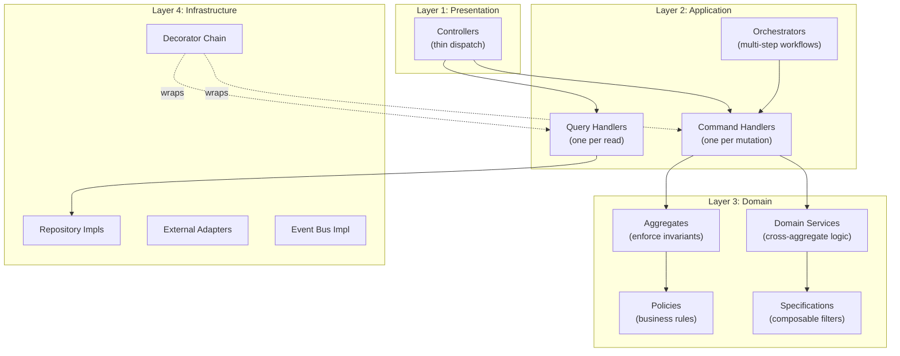
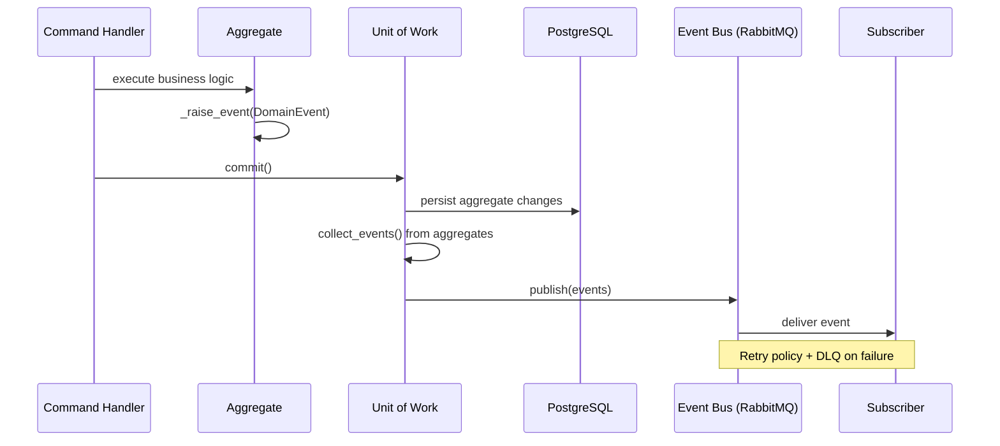

# 5. Service Architecture — v2

> **Enterprise Architecture Review**
>
> **v1 Weaknesses**: God services — "CallProcessingService" does STT, diarization,
> sentiment, intent, topics. "KnowledgeService" does chunking, embedding, search, versioning.
> No single responsibility. Services own both domain logic and infrastructure. No DI composition.
>
> **v2 Improvements**: Every "service" decomposed into single-responsibility Use Case Handlers.
> Domain services are thin (domain logic only). Infrastructure adapters are separate. DI container
> composes everything. Decorator chain handles cross-cutting.

---

## Architectural Layers — Applied



---

## Decomposed Services (No God Classes)

### v1 → v2 Decomposition

| v1 God Service | v2 Replacements (Single Responsibility Each) |
|----------------|----------------------------------------------|
| `IngestionService` | `IngestAudioHandler`, `IngestDocumentHandler`, `IngestWebsiteHandler` |
| `CallProcessingService` | `StartTranscriptionHandler`, `AnalyzeCallHandler`, `DiarizeSpeakersHandler`, `DetectSentimentHandler` |
| `ConversationMiningService` | `ExtractPatternsHandler`, `ClusterAgentsHandler`, `RankAgentsHandler` |
| `PlaybookGeneratorService` | `GeneratePlaybookHandler` + `PlaybookBuilder` + `PatternMiningService` (domain) |
| `PromptGeneratorService` | `GeneratePromptHandler` + `PromptBuilder` + `PromptCompiler` (domain) |
| `KnowledgeService` | `AddDocumentHandler`, `SearchKnowledgeHandler`, `ReindexHandler` + `RetrievalService` (domain) + `ChunkerFactory` (strategy) |
| `ConversationService` | `StartConversationHandler`, `ProcessTurnHandler`, `EndConversationHandler` + `TurnProcessingService` (domain) |
| `EvaluationService` | `EvaluateConversationHandler` + `EvaluatorFactory` (strategy) |
| `AgentManagerService` | `CreateAgentHandler`, `PublishAgentHandler`, `CloneAgentHandler` + `AgentFactory` |

---

## Use Case Handler Example: `CreateAgentHandler`

```python
# agent/application/commands/create_agent.py

@dataclass(frozen=True)
class CreateAgentCommand(Command):
    tenant_id: str
    workspace_id: str
    name: str
    type: str
    user_id: str

class CreateAgentHandler(CommandHandler[CreateAgentCommand, AgentDTO]):
    """
    Single responsibility: create one agent.
    Dependencies injected. No framework imports. No infrastructure.
    """

    def __init__(
        self,
        agent_repo: AgentRepository,        # Domain interface
        workspace_repo: OrganizationRepository,
        agent_factory: AgentFactory,         # Factory
        uow: UnitOfWork,                     # Transaction
    ):
        self._agent_repo = agent_repo
        self._workspace_repo = workspace_repo
        self._agent_factory = agent_factory
        self._uow = uow

    async def handle(self, cmd: CreateAgentCommand) -> Result[AgentDTO]:
        # 1. Validate workspace exists and belongs to tenant
        org = await self._workspace_repo.get_by_tenant(TenantId(cmd.tenant_id))
        if org is None:
            return Result.fail(Error("NOT_FOUND", "Organization not found"))

        workspace = org.get_workspace(WorkspaceId(cmd.workspace_id))
        if workspace is None:
            return Result.fail(Error("NOT_FOUND", "Workspace not found"))

        # 2. Check plan limits (aggregate invariant)
        agent_count = await self._agent_repo.count(
            AgentInWorkspaceSpec(WorkspaceId(cmd.workspace_id))
        )
        if agent_count >= org.plan.max_agents:
            return Result.fail(Error("LIMIT_EXCEEDED", "Agent limit reached"))

        # 3. Create via factory
        agent = self._agent_factory.create(
            workspace_id=WorkspaceId(cmd.workspace_id),
            name=AgentName(cmd.name),
            agent_type=AgentType(cmd.type),
        )

        # 4. Persist
        async with self._uow:
            await self._agent_repo.save(agent)
            await self._uow.commit()

        # 5. Return DTO (never expose domain entities to presentation)
        return Result.ok(AgentMapper.to_dto(agent))
```

---

## Factory Pattern — Applied

### `AgentFactory`

```python
# agent/domain/factories/agent_factory.py
class AgentFactory:
    """Creates Agent aggregates with sensible defaults per type."""

    _DEFAULTS: dict[AgentType, dict] = {
        AgentType.SALES: {
            "voice": AgentVoiceConfig(tts_provider="elevenlabs", ...),
            "llm": AgentLLMConfig(provider="gemini", model="gemini-2.0-flash", ...),
            "runtime": AgentRuntimeConfig(barge_in_enabled=True, ...),
        },
        AgentType.SUPPORT: {
            "voice": AgentVoiceConfig(tts_provider="elevenlabs", ...),
            "llm": AgentLLMConfig(provider="gemini", model="gemini-2.0-flash", ...),
            "runtime": AgentRuntimeConfig(barge_in_enabled=True, ...),
        },
        # ... per type
    }

    def create(
        self, workspace_id: WorkspaceId, name: AgentName, agent_type: AgentType
    ) -> Agent:
        defaults = self._DEFAULTS.get(agent_type, self._DEFAULTS[AgentType.CUSTOM])
        agent = Agent(
            id=AgentId(),
            workspace_id=workspace_id,
            name=name,
            type=agent_type,
            status=AgentStatus.DRAFT,
            voice_config=defaults["voice"],
            runtime_config=defaults["runtime"],
            llm_config=defaults["llm"],
            memory_config=AgentMemoryConfig.default(),
            tools=[],
            policies=[AgentPolicy.default_fallback()],
        )
        agent._raise_event(AgentCreated(
            agent_id=str(agent.id.value),
            workspace_id=str(workspace_id.value),
            agent_type=agent_type.value,
        ))
        return agent
```

### `ChunkerFactory` (Strategy Selection)

```python
# knowledge/domain/factories/chunker_factory.py
class ChunkerFactory:
    """Selects chunking strategy based on document type and configuration."""

    _STRATEGIES: dict[ChunkingStrategy, type] = {
        ChunkingStrategy.RECURSIVE: "RecursiveChunker",
        ChunkingStrategy.SEMANTIC: "SemanticChunker",
        ChunkingStrategy.QA_PAIR: "QAPairChunker",
        ChunkingStrategy.TABLE: "TableChunker",
        ChunkingStrategy.CONVERSATION: "ConversationChunker",
    }

    def __init__(self, chunkers: dict[ChunkingStrategy, Chunker]):
        self._chunkers = chunkers

    def create(self, config: ChunkingConfig) -> Chunker:
        chunker = self._chunkers.get(config.strategy)
        if chunker is None:
            raise ValueError(f"Unknown strategy: {config.strategy}")
        return chunker
```

---

## Builder Pattern — Applied

### `PlaybookBuilder`

```python
# playbook/domain/factories/playbook_builder.py
class PlaybookBuilder:
    """
    Step-by-step construction of a complex Playbook aggregate.
    Ensures all required sections are populated before build().
    """

    def __init__(self, agent_id: AgentId):
        self._agent_id = agent_id
        self._role: RoleDefinition | None = None
        self._persona: PersonaDefinition | None = None
        self._stages: list[ConversationStage] = []
        self._objection_handlers: list[ObjectionStrategy] = []
        self._compliance_rules: list[ComplianceRule] = []
        self._policies: list[BusinessPolicy] = []
        self._fallbacks: list[FallbackBehavior] = []
        self._constraints: ConversationConstraints | None = None

    def with_role(self, role: RoleDefinition) -> PlaybookBuilder:
        self._role = role
        return self

    def with_persona(self, persona: PersonaDefinition) -> PlaybookBuilder:
        self._persona = persona
        return self

    def add_stage(self, stage: ConversationStage) -> PlaybookBuilder:
        self._stages.append(stage)
        return self

    def add_objection_handler(self, handler: ObjectionStrategy) -> PlaybookBuilder:
        self._objection_handlers.append(handler)
        return self

    def add_compliance_rule(self, rule: ComplianceRule) -> PlaybookBuilder:
        self._compliance_rules.append(rule)
        return self

    def add_fallback(self, fallback: FallbackBehavior) -> PlaybookBuilder:
        self._fallbacks.append(fallback)
        return self

    def with_constraints(self, constraints: ConversationConstraints) -> PlaybookBuilder:
        self._constraints = constraints
        return self

    def build(self) -> Result[Playbook]:
        """Validate completeness and return Playbook or Error."""
        if self._role is None:
            return Result.fail(Error("INCOMPLETE", "Role is required"))
        if self._persona is None:
            return Result.fail(Error("INCOMPLETE", "Persona is required"))
        if len(self._stages) == 0:
            return Result.fail(Error("INCOMPLETE", "At least one stage required"))
        if len(self._fallbacks) == 0:
            return Result.fail(Error("INCOMPLETE", "At least one fallback required"))

        playbook = Playbook(
            id=PlaybookId(),
            agent_id=self._agent_id,
            version=PlaybookVersion(1),
            status=PlaybookStatus.DRAFT,
            role=self._role,
            persona=self._persona,
            stages=self._stages,
            objection_handlers=self._objection_handlers,
            compliance_rules=self._compliance_rules,
            policies=self._policies,
            constraints=self._constraints or ConversationConstraints.default(),
            fallbacks=self._fallbacks,
        )
        playbook._raise_event(PlaybookGenerated(...))
        return Result.ok(playbook)
```

---

## Strategy Pattern — Complete Registry

| Strategy Interface | Implementations | Selection |
|-------------------|-----------------|-----------|
| `STTPort` | `DeepgramAdapter`, `WhisperAdapter`, `AssemblyAIAdapter` | Config → Factory |
| `TTSPort` | `ElevenLabsAdapter`, `CartesiaAdapter`, `GoogleTTSAdapter` | Config → Factory |
| `LLMPort` | `GeminiAdapter`, `OpenAIAdapter`, `ClaudeAdapter` | Config → Factory |
| `EmbeddingPort` | `OpenAIEmbeddingAdapter`, `CohereAdapter` | Config → Factory |
| `TelephonyPort` | `TwilioAdapter`, `SIPAdapter` | Config → Factory |
| `Chunker` | `RecursiveChunker`, `SemanticChunker`, `QAPairChunker`, `TableChunker` | `ChunkerFactory` |
| `Evaluator` | `LLMJudgeEvaluator`, `RuleBasedEvaluator` | `EvaluatorFactory` |
| `Retriever` | `DenseRetriever`, `SparseRetriever`, `HybridRetriever` | `RetrievalService` |
| `Reranker` | `CrossEncoderReranker`, `CohereReranker` | Config → Factory |

**Open/Closed Principle**: Adding a new STT provider = create one new adapter class implementing `STTPort`. Zero changes to existing code.

---

## DI Container Composition

```python
# presentation/container.py
class Container:
    """
    Composition Root. All wiring happens here. Every dependency is
    registered once. No service locator anti-pattern.
    """

    def __init__(self, settings: AppSettings):
        self._settings = settings

        # ─── Infrastructure (Driven Adapters) ───
        self.db_session_factory = create_session_factory(settings.database_url)
        self.uow = PgUnitOfWork(self.db_session_factory)
        self.event_bus = RabbitMQEventBus(settings.rabbitmq_url)
        self.cache = RedisCacheAdapter(settings.redis_url)
        self.storage = S3Adapter(settings.s3_bucket, settings.s3_region)
        self.stt = self._create_stt(settings.stt_provider)
        self.tts = self._create_tts(settings.tts_provider)
        self.llm = self._create_llm(settings.llm_provider)
        self.embedder = self._create_embedder(settings.embedding_provider)
        self.vector_store = QdrantAdapter(settings.qdrant_url)
        self.metrics = PrometheusMetrics()
        self.logger = StructuredLogger()

        # ─── Domain Factories ───
        self.agent_factory = AgentFactory()
        self.playbook_builder_factory = PlaybookBuilderFactory()
        self.prompt_builder_factory = PromptBuilderFactory()
        self.chunker_factory = ChunkerFactory({...})
        self.evaluator_factory = EvaluatorFactory(self.llm)

        # ─── Repositories ───
        self.agent_repo = PgAgentRepository(self.db_session_factory)
        self.playbook_repo = PgPlaybookRepository(self.db_session_factory)
        self.prompt_repo = PgPromptRepository(self.db_session_factory)
        self.conversation_repo = PgConversationRepository(self.db_session_factory)
        self.knowledge_repo = PgKnowledgeBaseRepository(self.db_session_factory)
        self.evaluation_repo = PgEvaluationRepository(self.db_session_factory)

        # ─── Application Handlers (with Decorator Chains) ───
        self.create_agent_handler = self._decorate_command(
            CreateAgentHandler(self.agent_repo, self.org_repo, self.agent_factory, self.uow),
            resource=Resource.AGENT, action=Action.CREATE,
        )

    def _decorate_command(self, handler, resource, action):
        """Compose decorator chain (outermost first)."""
        handler = ValidationDecorator(handler, handler.validator)
        handler = AuthorizationDecorator(handler, self.auth, resource, action)
        handler = TransactionDecorator(handler, self.uow)
        handler = LoggingDecorator(handler, self.logger)
        handler = MetricsDecorator(handler, self.metrics)
        return handler

    def _create_stt(self, provider: str) -> STTPort:
        return {
            "deepgram": DeepgramAdapter,
            "whisper": WhisperAdapter,
            "assemblyai": AssemblyAIAdapter,
        }[provider](self._settings)
```

---

## Event-Driven Communication (Revised)



**Key Rule**: Events are published **after** database commit. This ensures event handlers never process events for uncommitted data (transactional outbox pattern for reliability).
