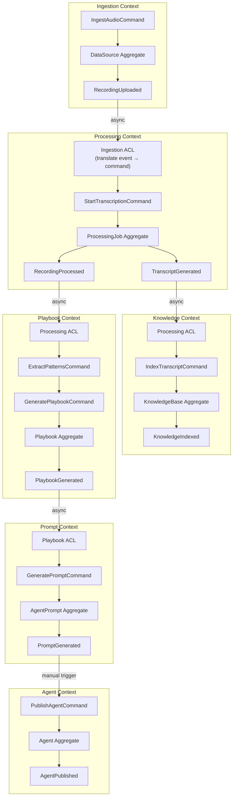
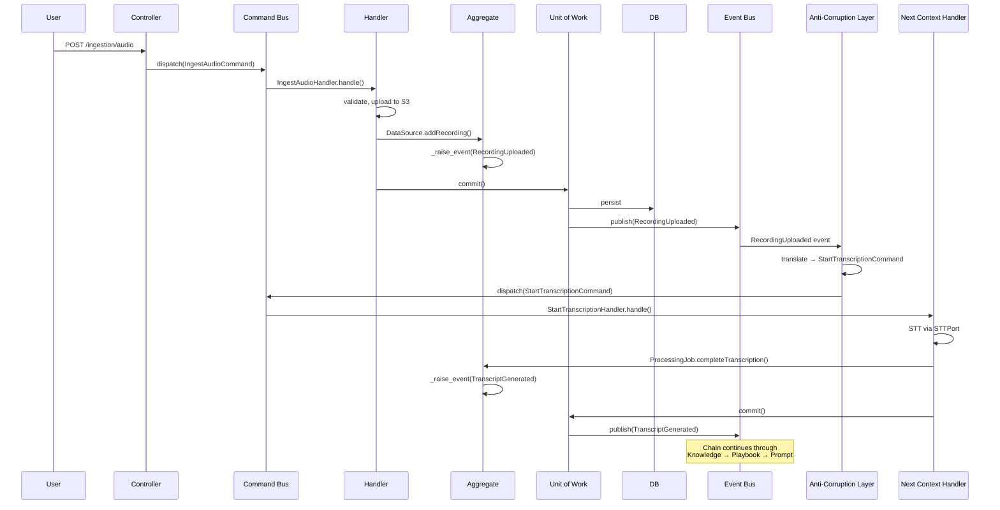
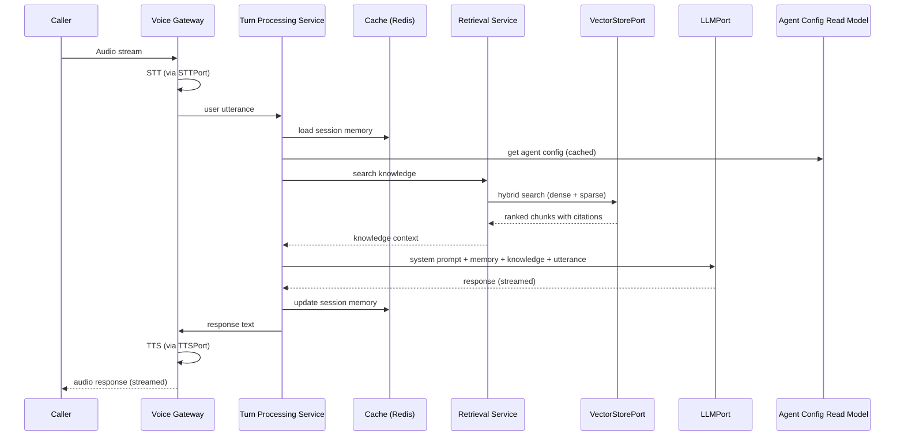
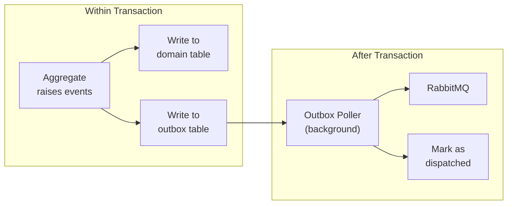
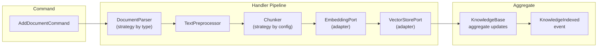

# 6. Data Flow — v2

> **Enterprise Architecture Review**
>
> **v1 Weaknesses**: Data flows described in terms of services, not domain events.
> No aggregate boundaries shown. No command/query distinction in flows. Missing
> anti-corruption layers between contexts.
>
> **v2 Improvements**: All flows expressed as Command → Aggregate → Event → Handler chains.
> ACL boundaries shown. CQRS read/write paths distinguished.

---

## Master Data Flow: Domain Event Chain



### Key Design Decisions

| Decision | Rationale |
|----------|-----------|
| Every arrow between contexts goes through an **ACL** | Prevents domain model leakage |
| Every context boundary is **async** (event-driven) | Temporal decoupling, independent deployment |
| Aggregates own their events | Events are raised within aggregate methods, dispatched after commit |
| Final step (Publish) is **manual** | Human-in-the-loop before agent goes live |

---

## Write Path: Agent Cloning Pipeline



---

## Read Path: Live Conversation (CQRS Query Side)



**Note**: The live conversation path is read-heavy (no aggregate mutations during the conversation). Conversation persistence happens asynchronously after the conversation ends, via `ConversationEndedEvent`.

---

## Event Dispatch: Transactional Outbox Pattern



```sql
CREATE TABLE outbox (
    id          UUID PRIMARY KEY,
    event_type  VARCHAR NOT NULL,
    payload     JSONB NOT NULL,
    tenant_id   UUID NOT NULL,
    created_at  TIMESTAMP NOT NULL DEFAULT NOW(),
    dispatched  BOOLEAN NOT NULL DEFAULT FALSE,
    dispatched_at TIMESTAMP
);

CREATE INDEX idx_outbox_undispatched
    ON outbox (created_at) WHERE dispatched = FALSE;
```

This ensures **exactly-once semantics**: events survive application crashes and are reliably delivered.

---

## Knowledge Indexing Flow



---

## Evaluation Flow

```mermaid
graph LR
    subgraph "Trigger"
        EVT_IN["ConversationEnded<br/>event"]
    end

    subgraph "ACL"
        CONV_ACL["Conversation ACL<br/>(translate event)"]
    end

    subgraph "Handler"
        CMD["EvaluateConversationCommand"]
        EVAL_H["EvaluateConversationHandler"]
        FACTORY["EvaluatorFactory<br/>(strategy selection)"]
        JUDGE["LLMJudgeEvaluator<br/>or RuleBasedEvaluator"]
    end

    subgraph "Aggregate"
        EVAL_AGG["Evaluation aggregate"]
        EVT_OUT["EvaluationCompleted<br/>event"]
    end

    subgraph "Read Model Update"
        ANALYTICS["Analytics Event Handler<br/>(refresh materialized views)"]
    end

    EVT_IN --> CONV_ACL --> CMD --> EVAL_H
    EVAL_H --> FACTORY --> JUDGE
    JUDGE --> EVAL_AGG --> EVT_OUT
    EVT_OUT --> ANALYTICS
```


