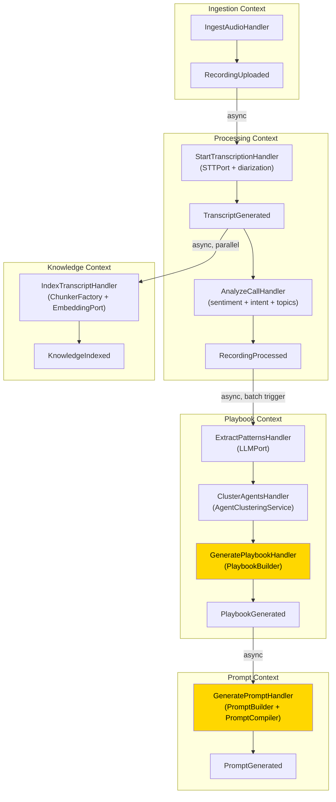

# 7. Agent Cloning Pipeline — v2

> **Enterprise Architecture Review**
>
> **v1 Weaknesses**: Pipeline described as monolithic stages. No bounded context ownership.
> No aggregate boundaries. "Mining Service" is a God class. No factory/builder for playbook
> construction. Quality gates not enforced via domain invariants.
>
> **v2 Improvements**: Each stage maps to a Command Handler in its bounded context.
> Builder pattern for Playbook construction. Specification pattern for quality gates.
> Domain services for cross-aggregate logic (clustering, ranking).

---

## Pipeline as Domain Event Chain



**Yellow = Builder pattern**: Complex construction with validation.

---

## Stage 1-2: Ingestion + Processing

Ownership: `Ingestion Context` and `Processing Context`.

No changes from v1 stage logic. Key v2 improvement:

- STT is accessed via **`STTPort`** (not concrete Deepgram class).
- Processing results stored via **`ProcessingJobRepository`** (not direct DB calls).
- Diarization, sentiment, intent are **separate methods on the ProcessingJob aggregate**, each raising sub-events.

---

## Stage 3: Conversation Mining → Playbook Generation

### Pattern Extraction (Domain Service)

```python
# playbook/domain/services/pattern_mining_service.py
class PatternMiningService(DomainService):
    """
    Extracts behavioral patterns from processed transcripts.
    Uses LLMPort but contains domain logic for structuring output.
    """

    def __init__(self, llm: LLMPort):
        self._llm = llm

    async def extract_patterns(
        self, transcripts: list[ProcessedTranscript]
    ) -> MinedPatterns:
        # LLM extracts raw patterns
        raw = await self._llm.generate(
            messages=self._build_extraction_prompt(transcripts),
            config={"temperature": 0.2}
        )
        # Domain logic structures and validates patterns
        return MinedPatterns(
            greeting_styles=self._parse_greetings(raw),
            discovery_questions=self._parse_questions(raw),
            rapport_techniques=self._parse_techniques(raw),
            objection_handlers=self._parse_objections(raw),
            closing_techniques=self._parse_closings(raw),
            conversation_flow=self._parse_flow(raw),
        )
```

### Agent Clustering (Domain Service)

```python
# playbook/domain/services/agent_clustering_service.py
class AgentClusteringService(DomainService):
    """
    Clusters agents by performance and identifies top performers.
    Pure domain logic — no infrastructure dependencies.
    """

    def rank_agents(
        self, agent_metrics: list[AgentPerformanceMetric]
    ) -> RankedAgents:
        scores = [self._compute_score(m) for m in agent_metrics]
        threshold = self._percentile(scores, percentile=80)
        top_performers = [
            m for m, s in zip(agent_metrics, scores) if s >= threshold
        ]
        return RankedAgents(
            top_performers=top_performers,
            threshold_score=Score(threshold),
        )

    def _compute_score(self, m: AgentPerformanceMetric) -> float:
        return (
            0.30 * m.conversion_rate.value +
            0.20 * m.csat_score.value +
            0.15 * m.sentiment_recovery_rate.value +
            0.15 * m.objection_handling_rate.value +
            0.10 * m.call_efficiency.value +
            0.10 * m.compliance_score.value
        )
```

### Playbook Construction (Builder)

Orchestrated by `GeneratePlaybookHandler`:

```python
# playbook/application/commands/generate_playbook.py
class GeneratePlaybookHandler(CommandHandler[GeneratePlaybookCommand, PlaybookDTO]):

    def __init__(
        self,
        mining_service: PatternMiningService,
        clustering_service: AgentClusteringService,
        playbook_repo: PlaybookRepository,
        processing_repo: ProcessingJobRepository,  # read interface
        uow: UnitOfWork,
    ):
        ...

    async def handle(self, cmd: GeneratePlaybookCommand) -> Result[PlaybookDTO]:
        # 1. Gather processed transcripts
        jobs = await self._processing_repo.find(
            ProcessedByAgentSpec(AgentId(cmd.agent_id))
        )
        if len(jobs) < 10:
            return Result.fail(Error("INSUFFICIENT_DATA",
                "Minimum 10 recordings required"))

        # 2. Mine patterns (domain service)
        patterns = await self._mining_service.extract_patterns(
            [j.transcript for j in jobs]
        )

        # 3. Rank agents (domain service)
        ranked = self._clustering_service.rank_agents(
            [j.agent_metric for j in jobs]
        )

        # 4. Build playbook (builder pattern)
        result = (
            PlaybookBuilder(AgentId(cmd.agent_id))
            .with_role(patterns.inferred_role)
            .with_persona(patterns.inferred_persona)
            .add_stages(patterns.conversation_flow)
            .add_objection_handlers(patterns.objection_handlers)
            .add_compliance_rules(cmd.compliance_rules)
            .add_fallback(FallbackBehavior.default())
            .with_constraints(ConversationConstraints.default())
            .build()
        )

        if result.is_failure:
            return result

        # 5. Persist
        async with self._uow:
            await self._playbook_repo.save(result.value)
            await self._uow.commit()

        return Result.ok(PlaybookMapper.to_dto(result.value))
```

---

## Quality Gates as Specifications

```python
# playbook/domain/specifications/
class SufficientDataSpec(Specification[list[ProcessingJob]]):
    """Checks that minimum data threshold is met."""
    MIN_RECORDINGS = 10

    def is_satisfied_by(self, jobs: list[ProcessingJob]) -> bool:
        return len(jobs) >= self.MIN_RECORDINGS

class HighConfidenceTranscriptSpec(Specification[ProcessingJob]):
    """Checks STT confidence meets threshold."""
    MIN_CONFIDENCE = 0.85

    def is_satisfied_by(self, job: ProcessingJob) -> bool:
        return job.transcript.confidence >= self.MIN_CONFIDENCE

class PlaybookCompletenessSpec(Specification[Playbook]):
    """Checks that a playbook has all required sections."""

    def is_satisfied_by(self, playbook: Playbook) -> bool:
        return (
            playbook.role is not None
            and playbook.persona is not None
            and len(playbook.stages) >= 1
            and len(playbook.fallbacks) >= 1
        )

class PromptSafetySpec(Specification[AgentPrompt]):
    """Checks prompt doesn't contain policy violations."""

    def is_satisfied_by(self, prompt: AgentPrompt) -> bool:
        # Check for prohibited patterns, PII leaks, etc.
        return all(g.is_enforced for g in prompt.guardrails)
```

---

## Pipeline Configuration (Value Object)

```python
@dataclass(frozen=True)
class PipelineConfig(ValueObject):
    stt_provider: str = "deepgram"
    diarization_enabled: bool = True
    sentiment_enabled: bool = True
    intent_detection_enabled: bool = True
    min_recordings: int = 10
    top_performer_percentile: int = 20
    chunking_strategy: str = "recursive"
    chunk_size: int = 512
    chunk_overlap: int = 50
    embedding_model: str = "text-embedding-3-small"
    auto_generate_prompt: bool = True

    def _validate(self) -> None:
        if self.min_recordings < 1:
            raise ValueError("min_recordings must be >= 1")
        if not 1 <= self.top_performer_percentile <= 100:
            raise ValueError("percentile must be 1-100")
```
