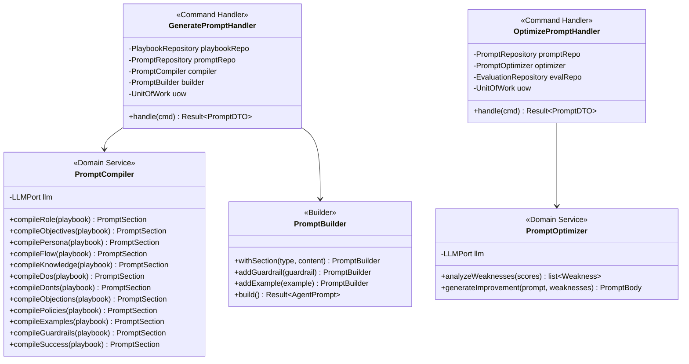

# 8. Prompt Generation Pipeline — v2

> **Enterprise Architecture Review**
>
> **v1 Weaknesses**: "PromptGeneratorService" is a God class doing template selection,
> compilation, LLM refinement, guardrail injection, and validation in a single method call.
> No Builder pattern for prompt construction. A/B testing logic mixed with generation logic.
>
> **v2 Improvements**: `PromptCompiler` (domain service) handles section compilation.
> `PromptBuilder` constructs AgentPrompt aggregate step by step. `PromptOptimizer` (domain
> service) handles A/B testing logic. Each is a separate single-responsibility class.

---

## Prompt Context Architecture



---

## Generation Flow

```python
# prompt/application/commands/generate_prompt.py
class GeneratePromptHandler(CommandHandler[GeneratePromptCommand, PromptDTO]):

    def __init__(
        self,
        playbook_repo: PlaybookRepository,
        prompt_repo: PromptRepository,
        compiler: PromptCompiler,
        uow: UnitOfWork,
    ):
        ...

    async def handle(self, cmd: GeneratePromptCommand) -> Result[PromptDTO]:
        # 1. Load playbook
        playbook = await self._playbook_repo.get_active(AgentId(cmd.agent_id))
        if playbook is None:
            return Result.fail(Error("NOT_FOUND", "No active playbook"))

        # 2. Compile each section (Domain Service)
        sections = {
            "role": await self._compiler.compile_role(playbook),
            "objectives": await self._compiler.compile_objectives(playbook),
            "persona": await self._compiler.compile_persona(playbook),
            "flow": await self._compiler.compile_flow(playbook),
            "knowledge": await self._compiler.compile_knowledge(playbook),
            "dos": await self._compiler.compile_dos(playbook),
            "donts": await self._compiler.compile_donts(playbook),
            "objections": await self._compiler.compile_objections(playbook),
            "policies": await self._compiler.compile_policies(playbook),
            "examples": await self._compiler.compile_examples(playbook),
            "guardrails": await self._compiler.compile_guardrails(playbook),
            "success": await self._compiler.compile_success(playbook),
        }

        # 3. Build AgentPrompt aggregate (Builder)
        builder = PromptBuilder(
            agent_id=AgentId(cmd.agent_id),
            playbook_id=playbook.id,
        )
        for section_type, section in sections.items():
            builder.with_section(section_type, section)

        # Add default guardrails
        for rule in playbook.compliance_rules:
            builder.add_guardrail(Guardrail(
                type=GuardrailType.COMPLIANCE,
                rule=rule.rule,
                action=rule.violation_action,
            ))

        # 4. Build and validate
        result = builder.build()
        if result.is_failure:
            return result

        # 5. Safety check (Specification)
        prompt = result.value
        if not PromptSafetySpec().is_satisfied_by(prompt):
            return Result.fail(Error("SAFETY_FAILED", "Prompt failed safety scan"))

        # 6. Persist
        async with self._uow:
            await self._prompt_repo.save(prompt)
            await self._uow.commit()

        return Result.ok(PromptMapper.to_dto(prompt))
```

---

## PromptCompiler (Domain Service)

```python
# prompt/domain/services/prompt_compiler.py
class PromptCompiler(DomainService):
    """
    Compiles playbook sections into prompt text.
    Uses LLMPort for refinement passes, but structuring logic is domain.
    """

    def __init__(self, llm: LLMPort):
        self._llm = llm

    async def compile_role(self, playbook: Playbook) -> PromptSection:
        raw = (
            f"You are {playbook.persona.name}, a {playbook.role.title} "
            f"at {playbook.role.company}, {playbook.role.department} department."
        )
        refined = await self._refine(raw, "role")
        return PromptSection(
            section_type="role",
            content=refined,
            token_count=self._count_tokens(refined),
        )

    async def compile_flow(self, playbook: Playbook) -> PromptSection:
        stages_text = []
        for stage in playbook.stages:
            stage_text = (
                f"### {stage.stage_name}\n"
                f"- Objective: {stage.objective}\n"
                f"- Duration: {stage.duration_min}-{stage.duration_max}s\n"
                f"- Techniques: {', '.join(stage.techniques)}\n"
                f"- Transition: Move to '{stage.next_stage}' when {stage.transition_trigger}\n"
            )
            stages_text.append(stage_text)
        content = "## Conversation Flow\n\n" + "\n".join(stages_text)
        return PromptSection(
            section_type="flow",
            content=content,
            token_count=self._count_tokens(content),
        )

    async def _refine(self, raw: str, section: str) -> str:
        """LLM pass for clarity, coherence, and conciseness."""
        result = await self._llm.generate(
            messages=[
                {"role": "system", "content": "Refine the following prompt section..."},
                {"role": "user", "content": raw}
            ],
            config={"temperature": 0.3, "max_tokens": 1000}
        )
        return result
```

---

## PromptBuilder

```python
# prompt/domain/factories/prompt_builder.py
class PromptBuilder:
    def __init__(self, agent_id: AgentId, playbook_id: PlaybookId):
        self._agent_id = agent_id
        self._playbook_id = playbook_id
        self._sections: list[PromptSection] = []
        self._guardrails: list[Guardrail] = []
        self._examples: list[PromptExample] = []

    def with_section(self, section_type: str, section: PromptSection) -> PromptBuilder:
        self._sections.append(section)
        return self

    def add_guardrail(self, guardrail: Guardrail) -> PromptBuilder:
        self._guardrails.append(guardrail)
        return self

    def add_example(self, example: PromptExample) -> PromptBuilder:
        self._examples.append(example)
        return self

    def build(self) -> Result[AgentPrompt]:
        # Validate required sections
        required = {"role", "objectives", "persona", "flow", "guardrails"}
        present = {s.section_type for s in self._sections}
        missing = required - present
        if missing:
            return Result.fail(Error("INCOMPLETE", f"Missing sections: {missing}"))

        # Compute total tokens
        total_tokens = sum(s.token_count for s in self._sections)

        body = PromptBody(
            sections=tuple(self._sections),
            total_token_count=total_tokens,
        )

        prompt = AgentPrompt(
            id=PromptId(),
            agent_id=self._agent_id,
            source_playbook_id=self._playbook_id,
            version=PromptVersion(1),
            body=body,
            guardrails=tuple(self._guardrails),
            examples=tuple(self._examples),
            status=PromptStatus.DRAFT,
            metrics=PromptMetrics.empty(),
        )
        prompt._raise_event(PromptGenerated(
            prompt_id=str(prompt.id.value),
            agent_id=str(self._agent_id.value),
            version=1,
        ))
        return Result.ok(prompt)
```

---

## Optimization Loop (Separate Handler)

```python
# prompt/application/commands/optimize_prompt.py
class OptimizePromptHandler(CommandHandler[OptimizePromptCommand, PromptDTO]):

    def __init__(
        self,
        prompt_repo: PromptRepository,
        eval_repo: EvaluationRepository,
        optimizer: PromptOptimizer,
        uow: UnitOfWork,
    ):
        ...

    async def handle(self, cmd: OptimizePromptCommand) -> Result[PromptDTO]:
        # 1. Load current prompt
        current = await self._prompt_repo.get_active(AgentId(cmd.agent_id))
        if current is None:
            return Result.fail(Error("NOT_FOUND", "No active prompt"))

        # 2. Load evaluation scores
        scores = await self._eval_repo.get_aggregate_scores(
            AgentId(cmd.agent_id), min_conversations=100
        )
        if scores is None:
            return Result.fail(Error("INSUFFICIENT_DATA", "Need 100+ conversations"))

        # 3. Analyze weaknesses (Domain Service)
        weaknesses = self._optimizer.analyze_weaknesses(scores)

        # 4. Generate improved prompt body (Domain Service)
        improved_body = await self._optimizer.generate_improvement(
            current.body, weaknesses
        )

        # 5. Create new version
        new_prompt = current.create_optimized_version(improved_body)

        # 6. Persist
        async with self._uow:
            await self._prompt_repo.save(new_prompt.value)
            await self._uow.commit()

        return Result.ok(PromptMapper.to_dto(new_prompt.value))
```

---

## A/B Testing (Separate Bounded Concern)

```python
# prompt/application/commands/create_ab_test.py
@dataclass(frozen=True)
class CreateABTestCommand(Command):
    agent_id: str
    variant_a_prompt_id: str
    variant_b_prompt_id: str
    traffic_split: float = 0.5
    min_conversations: int = 100
    min_duration_days: int = 7

class CreateABTestHandler(CommandHandler):
    """Creates A/B test between two prompt versions. Separate from generation."""
    ...
```

The A/B test activation, routing, and statistical evaluation are separate handlers — never mixed with prompt generation logic.
