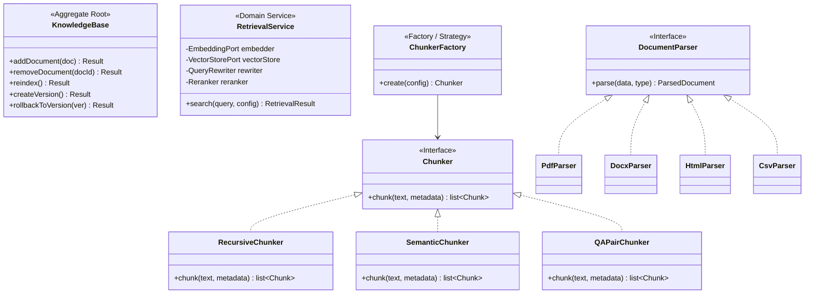

# 9. RAG Architecture — v2

> **Enterprise Architecture Review**
>
> **v1 Weaknesses**: "KnowledgeService" is a God class handling chunking, embedding,
> indexing, search, versioning, and citation all in one. Chunking strategy selection is
> a switch statement. No port abstractions for vector store or embedding. Query rewriting
> and reranking coupled with retrieval.
>
> **v2 Improvements**: Knowledge bounded context with `KnowledgeBase` aggregate.
> Strategy pattern via `ChunkerFactory`. Hexagonal ports: `EmbeddingPort`, `VectorStorePort`.
> `RetrievalService` (domain service) orchestrates hybrid search with composable retriever
> strategies. Each step is a single-responsibility class.

---

## Knowledge Context — Domain Model



---

## Indexing Pipeline (Write Path)

```python
# knowledge/application/commands/add_document.py
class AddDocumentHandler(CommandHandler[AddDocumentCommand, DocumentDTO]):

    def __init__(
        self,
        kb_repo: KnowledgeBaseRepository,
        parser_factory: DocumentParserFactory,    # Strategy
        chunker_factory: ChunkerFactory,          # Strategy
        embedder: EmbeddingPort,                  # Port
        vector_store: VectorStorePort,            # Port
        uow: UnitOfWork,
    ):
        ...

    async def handle(self, cmd: AddDocumentCommand) -> Result[DocumentDTO]:
        # 1. Load aggregate
        kb = await self._kb_repo.get_by_id(KnowledgeBaseId(cmd.kb_id))
        if kb is None:
            return Result.fail(Error("NOT_FOUND", "Knowledge base not found"))

        # 2. Parse document (Strategy: parser selected by doc type)
        parser = self._parser_factory.create(cmd.document_type)
        parsed = parser.parse(cmd.data, cmd.document_type)

        # 3. Chunk (Strategy: chunker selected by KB config)
        chunker = self._chunker_factory.create(kb.chunking_config)
        chunks = chunker.chunk(parsed.text, parsed.metadata)

        # 4. Embed (Port)
        texts = [c.text for c in chunks]
        vectors = await self._embedder.embed(texts)

        # 5. Index (Port)
        records = [
            {
                "id": str(c.id),
                "vector": v,
                "payload": {
                    "text": c.text,
                    "document_id": str(cmd.document_id),
                    "kb_id": str(cmd.kb_id),
                    "org_id": str(cmd.tenant_id),
                    "source": c.source,
                    "title": c.title,
                    "page": c.page,
                    "section": c.section,
                    "category": c.category,
                    "chunk_index": c.index,
                }
            }
            for c, v in zip(chunks, vectors)
        ]
        await self._vector_store.upsert(kb.embedding_config.collection_name, records)

        # 6. Update aggregate (domain logic)
        result = kb.add_document(KBDocument(
            id=DocumentId(cmd.document_id),
            title=parsed.title,
            chunk_count=len(chunks),
            status=DocumentStatus.INDEXED,
            source=SourceReference(cmd.source_url),
        ))
        if result.is_failure:
            return result

        # 7. Persist
        async with self._uow:
            await self._kb_repo.save(kb)
            await self._uow.commit()
        # Events: KnowledgeIndexed dispatched via outbox

        return Result.ok(DocumentMapper.to_dto(result.value))
```

---

## Retrieval Pipeline (Read Path)

```python
# knowledge/domain/services/retrieval_service.py
class RetrievalService(DomainService):
    """
    Orchestrates hybrid search: dense + sparse retrieval, fusion,
    filtering, reranking, and citation generation.
    Each component is injected, single-responsibility.
    """

    def __init__(
        self,
        embedder: EmbeddingPort,
        vector_store: VectorStorePort,
        query_rewriter: QueryRewriter,
        reranker: Reranker,
    ):
        self._embedder = embedder
        self._vector_store = vector_store
        self._query_rewriter = query_rewriter
        self._reranker = reranker

    async def search(
        self,
        query: str,
        config: RetrievalConfig,
    ) -> RetrievalResult:

        # 1. Rewrite query for search optimization
        rewritten = await self._query_rewriter.rewrite(query)

        # 2. Dense retrieval (vector similarity)
        query_vector = (await self._embedder.embed([rewritten]))[0]
        dense_results = await self._vector_store.search(
            collection=config.collection,
            vector=query_vector,
            top_k=config.top_k * 2,  # Over-fetch for reranking
            filters=config.filters,
        )

        # 3. Score fusion (if sparse results available)
        fused = self._reciprocal_rank_fusion(dense_results, config)

        # 4. Rerank with cross-encoder
        reranked = await self._reranker.rerank(query, fused, top_k=config.top_k)

        # 5. Build citations
        citations = [
            Citation(
                index=i + 1,
                source=r["payload"]["source"],
                title=r["payload"]["title"],
                page=r["payload"].get("page"),
                section=r["payload"].get("section"),
            )
            for i, r in enumerate(reranked)
        ]

        return RetrievalResult(
            chunks=[r["payload"]["text"] for r in reranked],
            citations=citations,
            scores=[r["score"] for r in reranked],
        )

    def _reciprocal_rank_fusion(
        self, dense: list[dict], config: RetrievalConfig
    ) -> list[dict]:
        """RRF score: Σ 1/(k + rank_i)"""
        k = 60
        scored = {}
        for rank, doc in enumerate(dense):
            doc_id = doc["id"]
            scored[doc_id] = scored.get(doc_id, 0) + 1 / (k + rank)
        # Sort by fused score
        sorted_ids = sorted(scored, key=scored.get, reverse=True)
        id_to_doc = {d["id"]: d for d in dense}
        return [
            {**id_to_doc[did], "score": scored[did]}
            for did in sorted_ids if did in id_to_doc
        ]
```

---

## Strategy Components

### QueryRewriter (Interface + Impl)

```python
# knowledge/domain — interface
class QueryRewriter(ABC):
    @abstractmethod
    async def rewrite(self, query: str) -> str: ...

# knowledge/infrastructure — implementation
class LLMQueryRewriter(QueryRewriter):
    def __init__(self, llm: LLMPort):
        self._llm = llm

    async def rewrite(self, query: str) -> str:
        result = await self._llm.generate(
            messages=[{"role": "system", "content": "Rewrite for search..."},
                      {"role": "user", "content": query}],
            config={"temperature": 0.1, "max_tokens": 100}
        )
        return result
```

### Reranker (Interface + Impl)

```python
# knowledge/domain — interface
class Reranker(ABC):
    @abstractmethod
    async def rerank(
        self, query: str, documents: list[dict], top_k: int
    ) -> list[dict]: ...

# knowledge/infrastructure — implementation
class CrossEncoderReranker(Reranker):
    """Uses a cross-encoder model to rerank results by relevance."""
    ...

class CohereReranker(Reranker):
    """Uses Cohere's rerank API."""
    ...
```

---

## Context Window Assembly (Value Object)

```python
@dataclass(frozen=True)
class AssembledContext(ValueObject):
    """
    Immutable assembled context for LLM input.
    Ensures token budget is respected.
    """
    system_prompt: str
    conversation_memory: list[dict]
    rag_results: list[str]
    rag_citations: list[Citation]
    customer_context: dict
    total_tokens: int

    TOKEN_BUDGET = {
        "system_prompt": 4000,
        "memory": 8000,
        "rag": 4000,
        "customer": 1000,
        "response_buffer": 2000,
    }

    def _validate(self) -> None:
        if self.total_tokens > sum(self.TOKEN_BUDGET.values()):
            raise ValueError("Context exceeds token budget")
```

---

## Adapter: QdrantAdapter

```python
# cross_cutting/adapters/vector/qdrant_adapter.py
class QdrantAdapter(VectorStorePort):
    """
    Adapter: implements VectorStorePort using Qdrant client.
    Infrastructure—never imported by domain or application layers.
    """

    def __init__(self, url: str, api_key: str | None = None):
        self._client = QdrantClient(url=url, api_key=api_key)

    async def upsert(self, collection: str, vectors: list[dict]) -> None:
        points = [
            PointStruct(
                id=v["id"],
                vector=v["vector"],
                payload=v["payload"],
            )
            for v in vectors
        ]
        self._client.upsert(collection_name=collection, points=points)

    async def search(
        self, collection: str, vector: list[float],
        top_k: int, filters: dict | None
    ) -> list[dict]:
        qdrant_filter = self._build_filter(filters) if filters else None
        results = self._client.search(
            collection_name=collection,
            query_vector=vector,
            limit=top_k,
            query_filter=qdrant_filter,
        )
        return [
            {"id": r.id, "score": r.score, "payload": r.payload}
            for r in results
        ]
```
