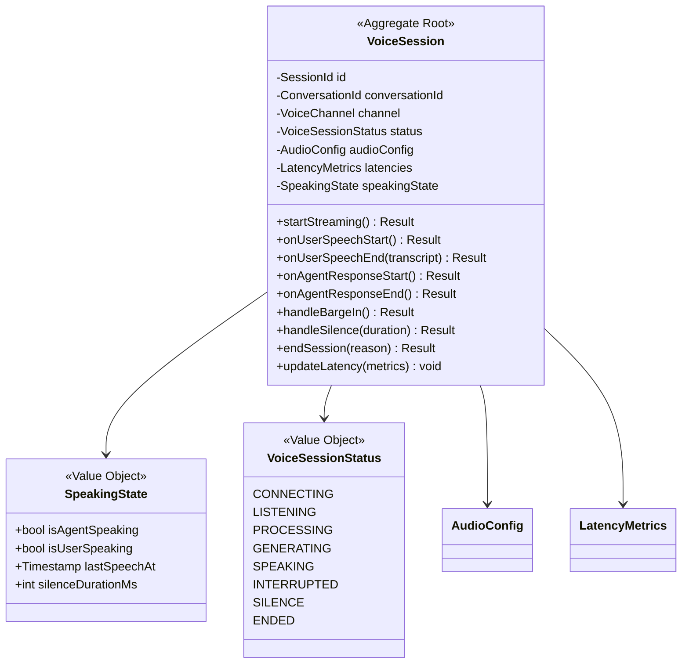
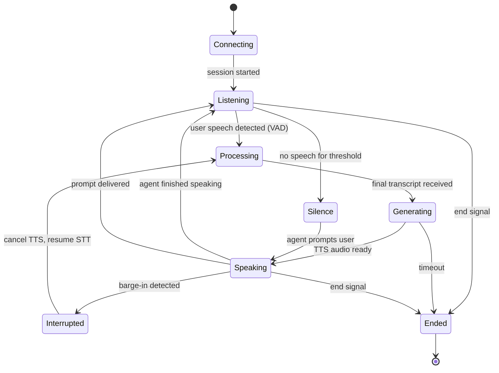
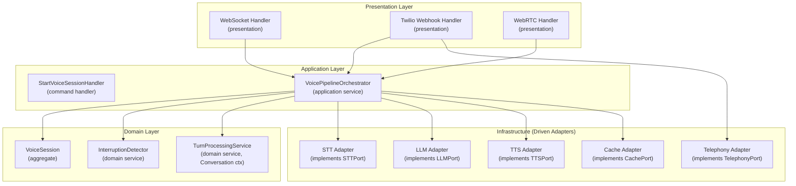

# 10. Voice Streaming Architecture — v2

> **Enterprise Architecture Review**
>
> **v1 Weaknesses**: Voice pipeline is a monolithic orchestrator calling STT, LLM, TTS
> directly. No port abstractions. Session state is an untyped dict. Barge-in detector is
> inline code. Twilio integration coupled to core pipeline. No aggregate for session.
>
> **v2 Improvements**: `VoiceSession` aggregate with typed state. All providers behind
> ports (STTPort, TTSPort, LLMPort, TelephonyPort). Pipeline as composition of
> single-responsibility components. `InterruptionDetector` as separate domain service.
> Twilio handler as adapter behind `TelephonyPort`.

---

## Voice Context — Domain Model



### Session State Machine



---

## Pipeline Architecture (Composition of Ports)



---

## VoicePipelineOrchestrator (Application Service)

```python
# voice/application/services/voice_pipeline_orchestrator.py
class VoicePipelineOrchestrator:
    """
    Orchestrates the real-time voice pipeline.
    Coordinates between ports (STT, LLM, TTS) and domain services.
    Single-responsibility: pipeline flow control only.
    """

    def __init__(
        self,
        stt: STTPort,
        tts: TTSPort,
        llm: LLMPort,
        turn_service: TurnProcessingService,
        interruption_detector: InterruptionDetector,
        session_cache: CachePort,
    ):
        self._stt = stt
        self._tts = tts
        self._llm = llm
        self._turn_service = turn_service
        self._interruption_detector = interruption_detector
        self._cache = session_cache

    async def process_audio_chunk(
        self,
        session: VoiceSession,
        audio_chunk: bytes,
    ) -> AsyncGenerator[AudioResponse, None]:

        # 1. Check for barge-in
        if session.speaking_state.is_agent_speaking:
            is_barge_in = self._interruption_detector.detect(
                audio_chunk, session.audio_config
            )
            if is_barge_in:
                session.handle_barge_in()
                yield AudioResponse(type="interrupt", data=b"")
                return

        # 2. STT (streaming)
        async for partial in self._stt.stream_transcribe(
            self._audio_generator(audio_chunk),
            language=session.audio_config.language,
        ):
            if partial.is_final:
                session.on_user_speech_end(partial.text)

                # 3. Process turn (domain service from Conversation context)
                response = await self._turn_service.process(
                    conversation_id=session.conversation_id,
                    user_input=partial.text,
                )

                # 4. TTS (streaming)
                session.on_agent_response_start()
                async for audio_bytes in self._tts.stream_synthesize(
                    response.text,
                    voice_id=response.voice_id,
                ):
                    yield AudioResponse(type="audio", data=audio_bytes)

                session.on_agent_response_end()
            else:
                yield AudioResponse(
                    type="partial_transcript",
                    text=partial.text,
                )
```

---

## InterruptionDetector (Domain Service)

```python
# voice/domain/services/interruption_detector.py
class InterruptionDetector(DomainService):
    """
    Detects user barge-in (user speaking while agent is talking).
    Pure domain logic: energy threshold + duration check.
    No infrastructure dependencies.
    """

    ENERGY_THRESHOLD: float = 0.02
    MIN_SPEECH_DURATION_MS: int = 200
    DEBOUNCE_WINDOW_MS: int = 100

    def detect(self, audio_chunk: bytes, config: AudioConfig) -> bool:
        rms_energy = self._compute_rms(audio_chunk, config)
        if rms_energy < self.ENERGY_THRESHOLD:
            return False
        # Would also check duration to avoid false positives from noise
        return True

    def detect_silence(
        self, last_speech_at: Timestamp, threshold_ms: int
    ) -> bool:
        elapsed = Timestamp.now().value - last_speech_at.value
        return elapsed.total_seconds() * 1000 > threshold_ms

    def _compute_rms(self, audio: bytes, config: AudioConfig) -> float:
        """Root Mean Square energy of audio chunk."""
        import struct
        samples = struct.unpack(f"<{len(audio)//2}h", audio)
        return (sum(s**2 for s in samples) / len(samples)) ** 0.5 / 32768.0
```

---

## Telephony Adapter (Twilio)

```python
# cross_cutting/adapters/telephony/twilio_adapter.py
class TwilioAdapter(TelephonyPort):
    """
    Adapter: implements TelephonyPort using Twilio SDK.
    Handles media stream transcoding (μ-law 8kHz ↔ PCM 16kHz).
    Infrastructure layer only.
    """

    def __init__(self, account_sid: str, auth_token: str):
        self._client = Client(account_sid, auth_token)

    async def create_call(self, to: str, from_: str, webhook_url: str) -> str:
        call = self._client.calls.create(
            to=to, from_=from_,
            url=webhook_url,
        )
        return call.sid

    async def end_call(self, call_sid: str) -> None:
        self._client.calls(call_sid).update(status="completed")

    async def transfer_call(self, call_sid: str, to: str) -> None:
        # Twilio warm transfer via conference
        ...

    def transcode_inbound(self, mulaw_audio: bytes) -> bytes:
        """μ-law 8kHz mono → PCM 16kHz mono for pipeline."""
        ...

    def transcode_outbound(self, pcm_audio: bytes) -> bytes:
        """PCM 16kHz mono → μ-law 8kHz mono for Twilio."""
        ...
```

---

## Latency Optimization (Unchanged Targets, Formalized)

| Stage | Target | Technique |
|-------|--------|-----------|
| VAD | 50ms | Local energy computation |
| STT | 150ms | Streaming API, partial transcripts |
| Context + RAG | 50ms | Cached agent config, pre-fetched context |
| LLM TTFT | 150ms | Streaming generation |
| TTS First Byte | 100ms | Streaming synthesis |
| **Total E2E** | **~500ms** | All stages streaming + pipelined |

**Key**: Sentence buffering — buffer first complete sentence before starting TTS to ensure natural speech rhythm.

---

## Session Persistence

```python
# VoiceSession is persisted to Redis (CachePort) for real-time access.
# After session ends → ConversationEndedEvent → full persistence to PostgreSQL.

# Session state is serialized as a typed model, NOT a raw dict.
@dataclass
class SessionState:
    session_id: str
    conversation_id: str
    agent_id: str
    channel: str
    status: str
    current_stage: str
    turn_count: int
    is_agent_speaking: bool
    is_user_speaking: bool
    last_speech_at: str
    latencies: dict
```
