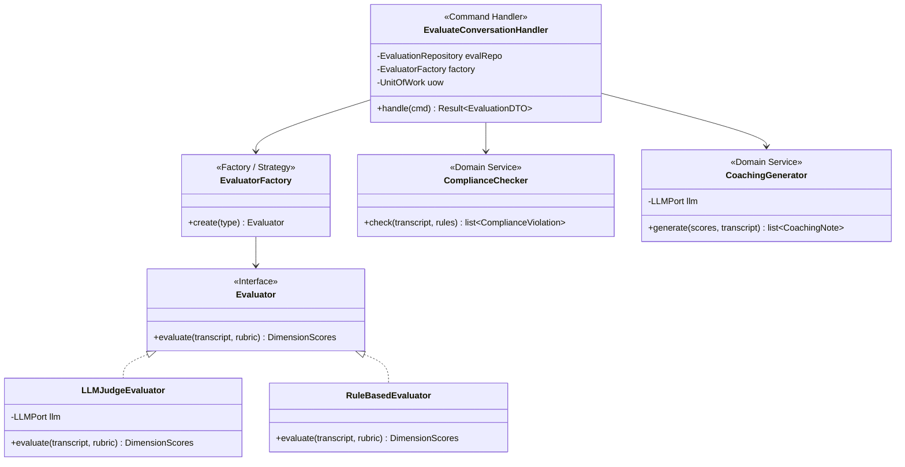
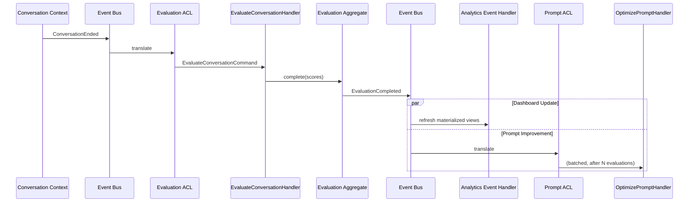

# 11. Evaluation Pipeline — v2

> **Enterprise Architecture Review**
>
> **v1 Weaknesses**: "EvaluationService" is a God class doing transcript analysis,
> multi-dimension scoring, compliance detection, coaching feedback, dashboard refresh,
> and feedback loop — all in one class. Scoring rubric is hardcoded. No strategy for
> different evaluation approaches.
>
> **v2 Improvements**: `Evaluation` aggregate owns scores and violations. `EvaluatorFactory`
> selects strategy (LLM-Judge vs rule-based). Compliance detection as separate specification.
> Dashboard refresh via CQRS event handler in Analytics context. Feedback loop via separate
> `OptimizePromptCommand` in Prompt context.

---

## Evaluation Context — Decomposed



---

## Handler

```python
# evaluation/application/commands/evaluate_conversation.py
class EvaluateConversationHandler(CommandHandler):

    def __init__(
        self,
        eval_repo: EvaluationRepository,
        evaluator_factory: EvaluatorFactory,
        compliance_checker: ComplianceChecker,
        coaching_generator: CoachingGenerator,
        uow: UnitOfWork,
    ):
        ...

    async def handle(self, cmd) -> Result[EvaluationDTO]:
        # 1. Create evaluation aggregate
        evaluation = Evaluation(
            id=EvaluationId(),
            conversation_id=ConversationId(cmd.conversation_id),
            agent_id=AgentId(cmd.agent_id),
            status=EvaluationStatus.IN_PROGRESS,
        )

        # 2. Score via strategy (EvaluatorFactory)
        evaluator = self._evaluator_factory.create(cmd.evaluation_type)
        scores = await evaluator.evaluate(cmd.transcript, cmd.rubric)
        evaluation.complete(scores)

        # 3. Check compliance (Domain Service)
        violations = self._compliance_checker.check(
            cmd.transcript, cmd.compliance_rules
        )
        for v in violations:
            evaluation.add_violation(v)

        # 4. Generate coaching (Domain Service)
        notes = await self._coaching_generator.generate(
            scores, cmd.transcript
        )
        evaluation.add_coaching_notes(notes)

        # 5. Persist
        async with self._uow:
            await self._eval_repo.save(evaluation)
            await self._uow.commit()
        # EvaluationCompleted event dispatched → Analytics + Prompt contexts

        return Result.ok(EvaluationMapper.to_dto(evaluation))
```

---

## ComplianceChecker (Domain Service)

```python
# evaluation/domain/services/compliance_checker.py
class ComplianceChecker(DomainService):
    """
    Checks transcript against compliance rules.
    Uses Specification pattern for each rule type.
    """

    def check(
        self, transcript: str, rules: list[ComplianceRule]
    ) -> list[ComplianceViolation]:
        violations = []
        for rule in rules:
            spec = self._rule_to_spec(rule)
            if not spec.is_satisfied_by(transcript):
                violations.append(ComplianceViolation(
                    rule=rule.rule,
                    severity=rule.severity,
                    evidence=spec.extract_evidence(transcript),
                    occurred_at=Timestamp.now(),
                ))
        return violations
```

---

## Cross-Context Event Flow



---

## Scoring Dimensions (Unchanged)

*(v1 scoring rubric and dimensions were well-designed. See v1 for full rubric table.)*
