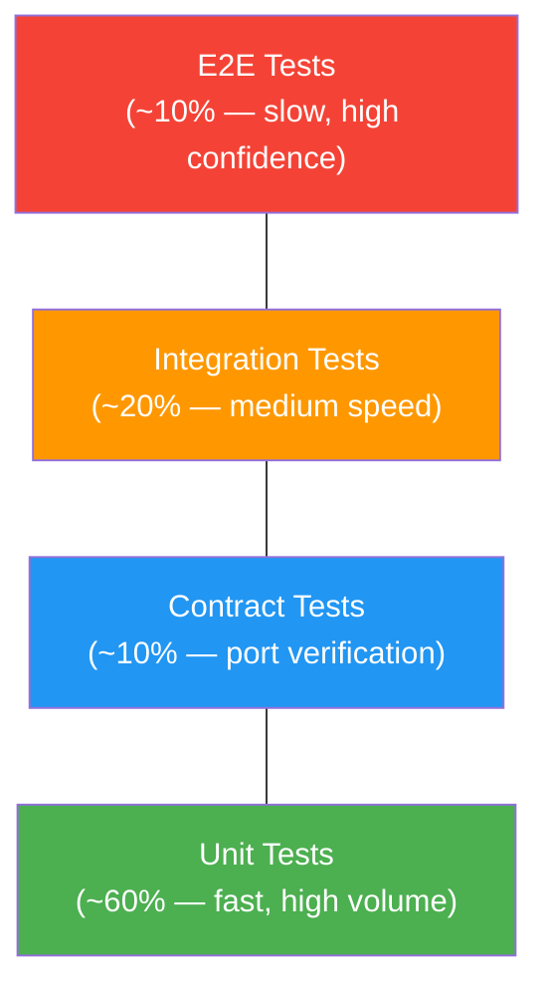

# 14. Testing Architecture

> **Enterprise Architecture Review — New Document**
>
> Defines the testing strategy aligned with Clean Architecture and DDD.
> Each architectural layer has a distinct testing approach.

---

## Testing Pyramid



---

## Layer-Specific Testing

### Domain Layer (Unit Tests)

| What to Test | How | Mocks |
|-------------|-----|-------|
| Aggregate invariants | Direct method calls on aggregate | None (pure domain) |
| Value object validation | Construct with invalid data | None |
| Domain services | Call with test data | Port interfaces (stubs) |
| Specifications | `is_satisfied_by()` with fixtures | None |
| Event raising | Assert events after aggregate method | None |

```python
# tests/unit/agent/domain/test_agent.py
class TestAgent:
    def test_cannot_publish_without_playbook(self):
        agent = AgentFactory().create(
            workspace_id=WorkspaceId(), name=AgentName("Test"), type=AgentType.SALES
        )
        result = agent.publish()
        assert result.is_failure
        assert result.error.code == "PRECONDITION_FAILED"

    def test_publish_raises_event(self):
        agent = self._create_publishable_agent()
        result = agent.publish()
        assert result.is_success
        assert any(isinstance(e, AgentPublished) for e in agent.domain_events)

    def test_tool_count_cannot_exceed_limit(self):
        agent = self._create_agent_with_tools(max_tools=5)
        result = agent.add_tool(self._create_tool())
        assert result.is_failure
        assert result.error.code == "LIMIT_EXCEEDED"
```

### Application Layer (Unit Tests)

| What to Test | How | Mocks |
|-------------|-----|-------|
| Command handlers | Inject mock repos + ports | All dependencies mocked |
| Query handlers | Inject mock repos | Repository mocked |
| Validation | Invalid command data | None |
| Error mapping | Handler returns Result.fail | Mock repos returning None |

```python
# tests/unit/agent/application/test_create_agent_handler.py
class TestCreateAgentHandler:
    @pytest.fixture
    def handler(self, mock_agent_repo, mock_org_repo, mock_uow):
        return CreateAgentHandler(mock_agent_repo, mock_org_repo, AgentFactory(), mock_uow)

    async def test_creates_agent_successfully(self, handler, mock_org):
        mock_org_repo.get_by_tenant.return_value = mock_org
        cmd = CreateAgentCommand(tenant_id="t1", workspace_id="w1", name="Test", type="sales", user_id="u1")
        result = await handler.handle(cmd)
        assert result.is_success
        assert result.value.name == "Test"

    async def test_fails_when_workspace_not_found(self, handler):
        mock_org_repo.get_by_tenant.return_value = None
        result = await handler.handle(cmd)
        assert result.is_failure
        assert result.error.code == "NOT_FOUND"
```

### Infrastructure Layer (Integration Tests)

| What to Test | How | Infra Required |
|-------------|-----|----------------|
| Repository implementations | Test against real DB | PostgreSQL (test container) |
| Adapter implementations | Test against real service | External API / mock server |
| Event bus | Publish + subscribe | RabbitMQ (test container) |
| Cache operations | Set + get + TTL | Redis (test container) |

```python
# tests/integration/persistence/test_pg_agent_repository.py
@pytest.mark.integration
class TestPgAgentRepository:
    @pytest.fixture
    def repo(self, test_db_session):
        return PgAgentRepository(test_db_session)

    async def test_save_and_retrieve(self, repo):
        agent = AgentFactory().create(...)
        await repo.save(agent)
        loaded = await repo.get_by_id(agent.id)
        assert loaded is not None
        assert loaded.name == agent.name

    async def test_find_by_specification(self, repo):
        await repo.save(self._create_agent(status=AgentStatus.PUBLISHED))
        await repo.save(self._create_agent(status=AgentStatus.DRAFT))
        results = await repo.find(ActiveAgentSpec())
        assert len(results) == 1
```

### Contract Tests (Port Verification)

```python
# tests/contract/test_stt_port_contract.py
class STTPortContract:
    """
    Contract that EVERY STT adapter must satisfy.
    Run against each implementation to ensure substitutability (LSP).
    """

    @abstractmethod
    def create_adapter(self) -> STTPort: ...

    async def test_transcribe_returns_text(self):
        adapter = self.create_adapter()
        result = await adapter.transcribe(self.sample_audio, "en-US")
        assert isinstance(result.text, str)
        assert len(result.text) > 0

    async def test_transcribe_returns_confidence(self):
        adapter = self.create_adapter()
        result = await adapter.transcribe(self.sample_audio, "en-US")
        assert 0.0 <= result.confidence <= 1.0

class TestDeepgramContract(STTPortContract):
    def create_adapter(self):
        return DeepgramAdapter(api_key=test_key)

class TestWhisperContract(STTPortContract):
    def create_adapter(self):
        return WhisperAdapter(model_path=test_model)
```

### E2E Tests

```python
# tests/e2e/test_agent_cloning_flow.py
@pytest.mark.e2e
class TestAgentCloningFlow:
    """Full pipeline: upload → process → playbook → prompt → publish"""

    async def test_full_pipeline(self, api_client):
        # 1. Upload recordings
        response = await api_client.post("/ingestion/audio", files=...)
        assert response.status_code == 201

        # 2. Wait for processing
        await self._wait_for_event("RecordingProcessed", timeout=60)

        # 3. Generate playbook
        response = await api_client.post(f"/agents/{agent_id}/playbook/generate")
        assert response.status_code == 201

        # 4. Generate prompt
        response = await api_client.post(f"/agents/{agent_id}/prompt/generate")
        assert response.status_code == 201

        # 5. Publish agent
        response = await api_client.post(f"/agents/{agent_id}/publish")
        assert response.status_code == 200
```

---

## Architecture Enforcement Tests

```python
# tests/architecture/test_dependency_rules.py
def test_domain_has_no_infrastructure_imports():
    """Inviolable: domain layer never imports infrastructure."""
    ...

def test_application_has_no_presentation_imports():
    """Application layer never imports controllers or schemas."""
    ...

def test_every_aggregate_has_invariant_tests():
    """Every aggregate root class has corresponding test file."""
    ...

def test_every_command_has_handler():
    """Every Command class has exactly one CommandHandler."""
    ...

def test_every_port_has_contract_test():
    """Every Port interface has a contract test class."""
    ...
```
